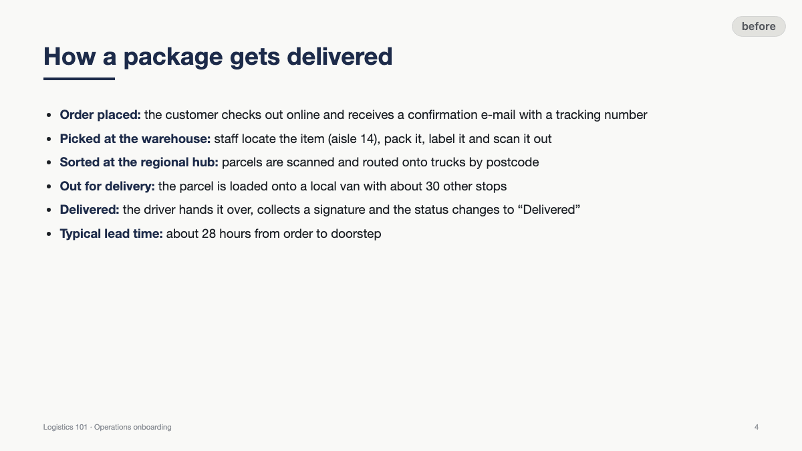
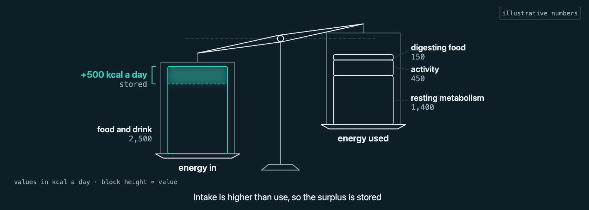
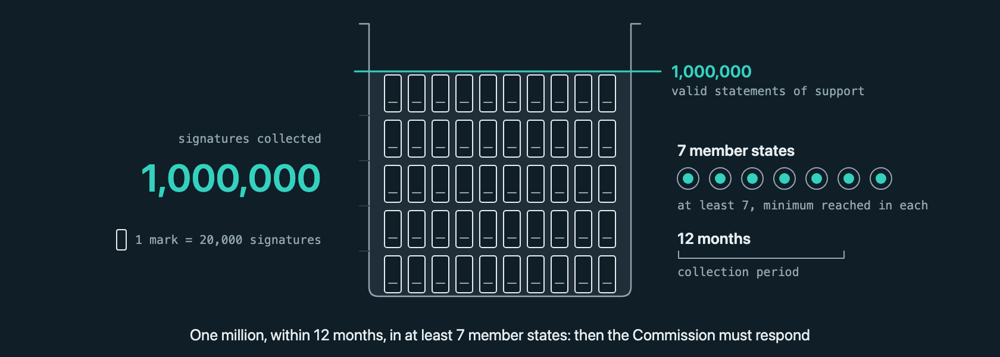
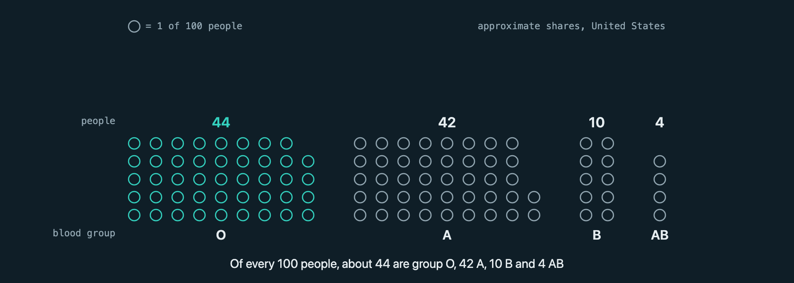
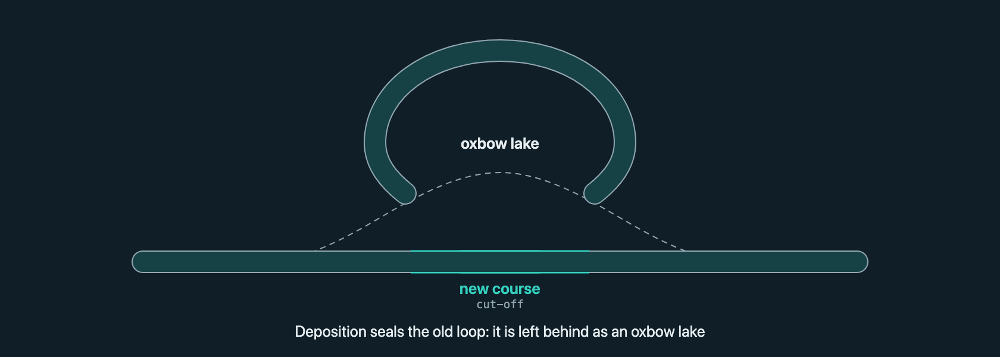
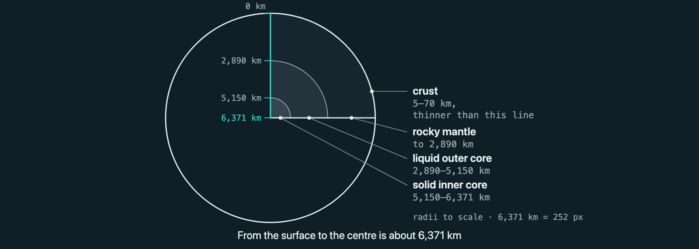
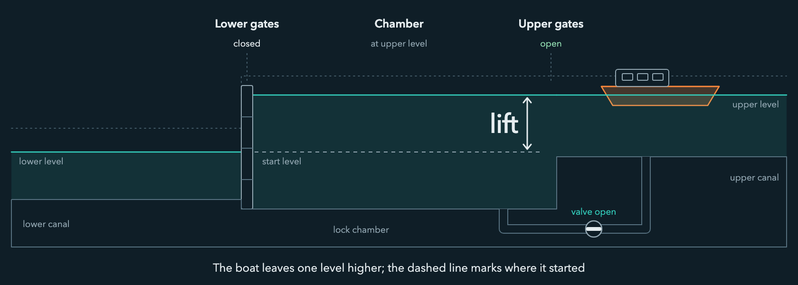
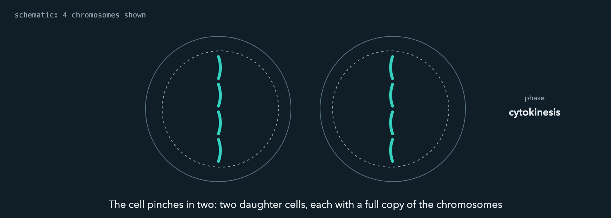
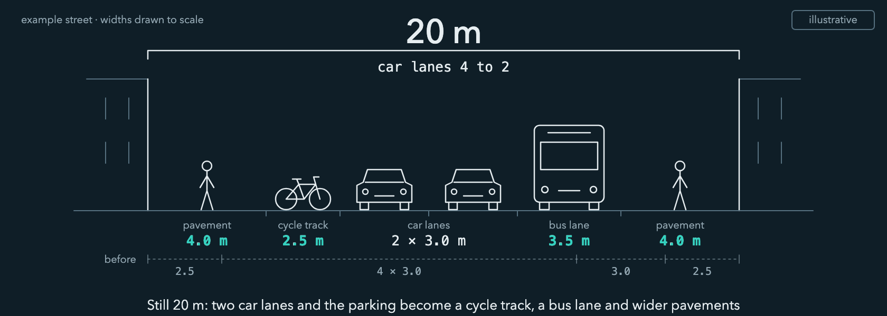
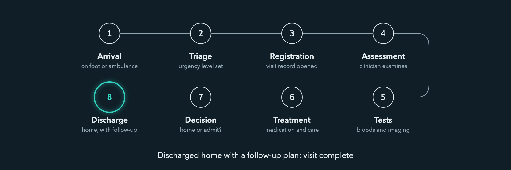

# anim-slides

[](https://github.com/KehanLiu/anim-slides/actions/workflows/ci.yml)
[](https://kehanliu.github.io/anim-slides/)
[](https://agentskills.io)
[](LICENSE)

**Turn boring bullet slides into animated diagrams, with the coding agent you already use.**

> ⭐ **If this skill helps you, please [give it a star](https://github.com/KehanLiu/anim-slides).** It is how other speakers find it.



```bash
npx skills add KehanLiu/anim-slides     # then ask your agent: "animate slide 4 of deck.html"
```

The GIF's "before" frame is [`examples/first-slide/source.html`](examples/first-slide/source.html)
as a browser renders it. The "after" frame is the [`parcel-route`](pool/parcel-route/) figure
from the skill's pool of examples, finished by hand from that slide. Every label in it comes
from the slide (`tests/test_readme_demo.py` fails the build otherwise).

## What it is

anim-slides is an agent skill. It turns slides, and written processes and dependencies, into
animated diagrams for HTML slide decks. It uses the open [Agent Skills](https://agentskills.io)
format, so the same folder works in Claude Code, Codex, Cursor, GitHub Copilot, Gemini CLI,
Antigravity, OpenCode, Amp, Cline, Roo Code, Kiro, Factory Droid, Zed, Goose and Devin Desktop.

It animates figures; it does not design decks. A deck skill (a skill that designs slide
decks: your own, or e.g. `frontend-slides`) builds the deck first, and anim-slides adds the figures. A small built-in
base deck is the fallback when no deck skill is installed.

Terms used on this page:

- **Figure:** an animated SVG illustration that replaces a text block, chart or screenshot on a slide.
- **Fragment:** the file a figure lives in: one HTML file with a `<style>` and one inline `<svg>`, which you paste into a slide.
- **Pass:** one run of a figure's animation, played when its slide is shown.
- **Resting frame:** the finished picture a pass ends on.
- **Match** and **lean:** the two looks. Match takes your deck's colours and fonts; lean puts the figures on their own dark background.

## Try it on one slide

One source slide, one prompt, one result. All three are in [`examples/first-slide/`](examples/first-slide/).

1. **Source:** [`source.html`](examples/first-slide/source.html), a six-bullet slide ("How a
   package gets delivered").
2. **Prompt**, typed in the folder that holds the slide, with the skill installed:

   ```text
   Turn the slide in source.html into an animated diagram that explains it. Write one self-contained HTML file, result.html, that opens from disk.
   ```

3. **Result:** [`result.html`](examples/first-slide/result.html), the unedited first output of
   that prompt from version 0.13.0 (Claude Code, `claude-opus-5-5`, 213 s, no follow-up). It
   keeps the slide's own light colours, so it looks different from the GIF. Open it from disk:
   it plays one pass and rests on the finished figure; reload to replay.

The result is one HTML file with a `<style>` block and one inline `<svg>`, animated with CSS
keyframes: no script, no framework, no network loads (see [What you get](#what-you-get)).

**With and without the skill.** The same prompt was run once without the skill (same model,
tools and harness). Both runs drew a real diagram. Without the skill the figure loops about
every 24 s, shows a status pill whose values the slide does not give, and prints an early step
without the lead time. With the skill (0.13.0) it plays once and every label traces to the
slide; two optional fixes remain (a faint bracket line, leftover render files). One run per
arm on one slide: an example, not a measurement.
[`docs/benchmark/first-slide/`](docs/benchmark/first-slide/README.md) has both outputs, timings,
screenshots and limits.

Then try the slide you find hardest to explain: "animate slide 4 of `deck.html`", or paste a
process and ask for a diagram.

## Gallery and pool

The skill ships a pool of 37 finished, checked fragments across 17 fields. Each is built on
the motion its point calls for: a jar that fills, a balance that tips, a crowd that sorts
itself, a river bend that becomes a lake, a boundary that closes around an outage. A dot
travelling along a line appears only where a named thing really travels. The agent picks the
motion from the slide's claim ([`references/motion-verbs.md`](references/motion-verbs.md)) and
starts from the closest entry before building from scratch.

The **[live gallery](https://kehanliu.github.io/anim-slides/)** shows them all animating. It
opens on one question ("When the payment provider goes down, can orders still go through?")
and answers it with the `service-deps` figure. You can download any entry as a playable demo
(one HTML file that opens from disk, with Replay) or copy it as embeddable HTML. Resting frames:

<table>
<tr>
<td><br><code>energy-balance</code> · balance</td>
<td><br><code>petition-threshold</code> · accumulate</td>
<td><br><code>blood-types</code> · sort</td>
</tr>
<tr>
<td><br><code>oxbow-lake</code> · transform</td>
<td><br><code>earth-layers</code> · open</td>
<td><br><code>canal-lock</code> · grow</td>
</tr>
<tr>
<td><br><code>mitosis</code> · split</td>
<td><br><code>street-redesign</code> · wipe</td>
<td><br><code>er-patient-flow</code> · travel</td>
</tr>
</table>

More in [`pool/README.md`](pool/README.md), including how to keep a private pool of your own.

## Install

The skill is one folder (`SKILL.md`, `references/`, `scripts/`, `pool/`, `base/`). Any harness that
reads the Agent Skills format picks it up from its skills directory; the folder name must stay
`anim-slides`.

### Option A: the `skills` installer (any harness)

[`skills`](https://github.com/vercel-labs/skills) detects the agents on your machine, keeps one
copy in `.agents/skills/anim-slides` (or `~/.agents/skills/` with `-g`) and links each agent's
own folder to it. Needs Node.js 22.20+.

```bash
npx skills add KehanLiu/anim-slides              # this project, agents detected on your machine
npx skills add KehanLiu/anim-slides -g -y        # for your user, all detected agents, no prompts
npx skills add KehanLiu/anim-slides -g -a codex cursor github-copilot -y   # chosen agents only
npx skills add KehanLiu/anim-slides --list       # show what would be installed
```

Amp has its own equivalent: `amp skill add KehanLiu/anim-slides` (`--global` for your user).
Gemini CLI: `gemini skills install https://github.com/KehanLiu/anim-slides --scope user`.

### Option B: clone into a skills folder

```bash
git clone https://github.com/KehanLiu/anim-slides <skills-dir>/anim-slides
```

`<skills-dir>` per harness (project path, then user path). A symlink to a clone elsewhere works
everywhere except inside a Claude Code plugin.

| Harness | Project | User |
|---|---|---|
| Codex, Cursor, Copilot, OpenCode, Amp, Roo Code, Droid, Zed, Goose, Devin Desktop | `.agents/skills/` | `~/.agents/skills/` |
| Claude Code | `.claude/skills/` | `~/.claude/skills/` |
| Cursor (own folder) | `.cursor/skills/` | `~/.cursor/skills/` |
| GitHub Copilot (own folder) | `.github/skills/` | `~/.copilot/skills/` |
| Gemini CLI | `.gemini/skills/` or `.agents/skills/` | `~/.gemini/skills/` |
| Antigravity | `.agents/skills/` | `~/.gemini/config/skills/` |
| OpenCode (own folder) | `.opencode/skills/` | `~/.config/opencode/skills/` |
| Cline | `.cline/skills/` | `~/.cline/skills/` |
| Kiro | `.kiro/skills/` | `~/.kiro/skills/` |
| Factory Droid (own folder) | `.factory/skills/` | `~/.factory/skills/` |
| Devin Desktop (own folder) | `.devin/skills/` | `~/.config/devin/skills/` |

Install one way per machine: two copies with the same name shadow each other.

### Option C: Claude Code plugin (the repo is its own marketplace)

```bash
claude plugin marketplace add KehanLiu/anim-slides
claude plugin install anim-slides@anim-slides-marketplace
```

or `/plugin marketplace add KehanLiu/anim-slides` then `/plugin install anim-slides@anim-slides-marketplace`
inside a session. Installed this way the skill is invoked as `/anim-slides:anim-slides`.
Update with `claude plugin marketplace update anim-slides-marketplace` and
`claude plugin update anim-slides@anim-slides-marketplace` (auto-update is off for third-party
marketplaces). For a one-off trial from a local clone: `claude --plugin-dir ./anim-slides`.

### Calling it by name

Harnesses pick the skill up automatically from its description. To call it by name, use
`/anim-slides` (Claude Code, Cursor, Copilot, Kiro, Droid, Antigravity, Devin Desktop) or
`$anim-slides` (Codex). In OpenCode, Zed, Goose, Gemini CLI and other harnesses, ask for it by
name.

### Requirements

Python 3.9+ and a Chrome or Chromium binary, for rendering and for the rendered checks
(`check_look.py`, `measure_slot.py`). Optional: `pyyaml` for full
YAML in specs (a built-in reader covers plain specs like the pool's, and JSON always works).

PowerPoint needs different things for reading and for rendering:

| Step | Script | Needs |
|---|---|---|
| Read a `.pptx` (text, bullets, notes, tables) | `extract_slides.py` | Python standard library only |
| Render a `.pptx`, `.ppt` or `.odp` to page images the agent looks at | `render_deck.py` | LibreOffice (`soffice`), poppler (`pdftoppm`), Chrome or Chromium |
| Render an HTML deck or a fragment | `render_deck.py`, `render-phases.sh` | Chrome or Chromium (`CHROME=/path` overrides detection); `render_deck.py` also needs `pdftoppm` |
| Build a duration comparison (bars racing on one time axis) from labels, values and units | `race_figure.py` (via `scaffold_from_spec.py`, `archetype: durations`) | none |
| Export a deck to PDF, one slide per Letter or A4 page, every label checked | `export_pdf.py` | Chrome or Chromium, poppler (`pdftotext`, `pdftoppm`) |
| Read a legacy `.ppt` | `extract_slides.py` | one `soffice --headless --convert-to pptx deck.ppt` first |

Install on macOS with `brew install --cask libreoffice` and `brew install poppler`; on
Debian or Ubuntu with `apt install libreoffice-impress poppler-utils`. Without LibreOffice the
skill still reads a PowerPoint's text; it cannot look at the slides. An HTML slide, like the
example above, needs only Python and Chrome.

The harness must be able to run shell commands and view PNG files. The scripts are called by
their path inside the skill folder, which Claude Code exposes as `$CLAUDE_SKILL_DIR` and other
harnesses report when they load the skill.

## Use

With the skill installed, ask your agent in plain words:

- "Make the pipeline slide in `deck.html` an animated illustration."
- "Convert `talk.pptx` to HTML with frontend-slides, then animate the process and architecture slides."
- "Here is our release procedure (paste). Turn it into an animated diagram for slide 7."
- "Animate this Mermaid flowchart for a 1200x600 slot."

**Question first.** The skill starts each slide from the one question its audience should be
able to answer. A slide that already answers it ships unchanged. A figure is added only where
the skill can name what the audience understands better by seeing a change unfold, and the
resting frame then shows that too. When no slide needs a figure, the deck is delivered as it
is, with one line per slide saying why.

For a whole deck, a run has three phases:

1. **Show first, ask once.** It outlines and renders your deck, drafts a triage table in
   `anim/triage.md` (which slides get a figure and why), builds and renders the first figure,
   and then asks one question with everything in it: the proposal, stills of that figure in
   the match and the lean look, and whether the file will be shared. Click-through is offered
   only when your deck already builds by click. For a PowerPoint it also says that an HTML deck
   has to be built first, what that costs, and offers standalone animated slide pages as a
   lighter path. No answer means the defaults, written down in `anim/triage.md`.
2. **Build silently.** The remaining figures, checked against the fragment rules, for
   legibility and for accuracy, then inlined into the deck.
3. **Deliver by showing.** A before/after review page of every animated slide, the deck, and
   two one-line switches for later (click-through, lean look).

For "animate slide N" and for a short prompt such as "make five slides about X" it asks
nothing and takes the defaults (your deck's own colours, play once, not bundled). A slide you
name always gets a figure; if the skill doubts that motion helps there, it says so in one line
after delivering it.

"Improve the slides" and "add more animations" mean the same to the skill: figures replace
text blocks and screenshots; nothing else about the deck changes.

**Built-in base.** When no deck skill is installed at all, a request like "Make five slides
introducing this project" still gets a designed deck: anim-slides builds it from its own small
base ([`base/`](base/README.md): five slide types, one look on a dark or a light background), then
adds the figures on top, and says so in one line. A deck skill such as frontend-slides offers
more looks; nothing is installed for you. See the [example deck](base/example.html), built on
the base. For a Markdown source, `scripts/md_to_deck.py --ground dark|light` makes a plain
deck in the base's colours and fonts.

**PDF.** When the deck will be printed or sent as a PDF, `scripts/export_pdf.py` writes one
Letter or A4 page per slide and checks that every label is on its page.

## What you get

Each figure is one fragment: a `<style>` plus one inline `<svg>` in a single HTML file,
animated with CSS keyframes, with no script, no framework and no network loads.

- **Drop-in.** Works in reveal.js, impress.js, Slidev, frontend-slides decks, hand-written HTML
  and plain scrolling pages. No framework, no build tool, no dependency.
- **Plays once, when shown.** A fragment plays one calm pass (4 to 10 s) when its slide becomes
  current and ends on the resting frame; nothing loops or pulses while you talk. Print, PDF
  export and reduced motion show the resting frame as a complete still.
- **Lean shapes.** Rings and hairlines, no boxes, one focal element (the thing the eye lands
  on), accent colour only on what is active or reached, monospace only for numbers and codes.
  `references/style.md` has the rules, and the drafts of `scaffold_from_spec.py` follow them.
- **Themed by variables.** Fragments read `--anim-theme-*` CSS variables and carry neutral
  fallbacks, so one `:root` rule rethemes every illustration to your brand.
- **Match or lean colours.** The skill settles one look per deck: *match* (the default for a
  designed or branded deck) takes your deck's palette and fonts through
  `scripts/host_theme.py`; *lean* puts the figures on their own dark background. Shapes stay lean
  either way: a branded deck gets rings and lines in its own blue, not its cards redrawn.
- **Safe to paste.** Every class, id and keyframe is prefixed, so nothing collides with the deck's
  own CSS.
- **Three control modes, one CSS fragment.** `once` (default) plays the pass when the slide appears;
  `step` plays the same fragment in phases, the entrance with the slide and each click landing
  the next phase, through a small host script with no library; `loop` for kiosks. Ask for
  step if you want to click through the phases.
- **Less by rule.** The fragment is the slide's own figure in its own form plus one movement.
  `check_fragment.py` counts how many things move and how many glow at the same instant, so
  "too much" fails before you see it.
- **Shareable.** The skill adds no CDN or network loads, and `bundle_deck.py` turns the deck
  into one self-contained HTML file for sharing, verified by `check_page.py`.
- **Verified by looking.** The skill renders phases of the pass to PNG and inspects them before
  it calls anything done ([Under the hood](#under-the-hood) lists the checks).

## Accuracy

A fragment adds motion, not facts. The skill is built to keep it that way:

- **Figures are redrawn, never dropped.** A chart, graph, table or scientific figure on the
  source slide is rebuilt from its data at exact scale and animated; only photos and decoration
  may go.
- **Every number is traced.** `scripts/verify_facts.py` compares a fragment's visible text and
  numbers with the source slide (title, bullets, notes, tables): an invented number, date or
  ratio fails the build, untraceable wording is listed for review, and facts pulled from a
  neighbouring slide are reported separately. Illustrative values must say so on the slide.
- **Values stay with their labels.** With "Checkout latency: 200 ms" and "Search latency:
  80 ms" on the slide, a figure that shows Checkout at 80 ms fails `--strict`; the right pairs
  pass in any row order; a case the tool cannot decide is listed for a person to review
  (`tests/test_verify_facts.py`).
- **Source wording wins.** Labels use the slide's own words; "approved" stays "approved" and
  does not become "signed into law".
- **Checked on real decks.** The rules come from converting six openly licensed decks (among
  them CDC, NOAA, Lumen Learning, Sorbonne and SNAP) and auditing every rebuilt slide against its original.

`references/accuracy.md` has the full rules and a checklist for the brief each figure starts from.

## Under the hood

### How it works

A *spec* lists a figure's nodes, links and timed phases; a *brief* states its question,
insight and beats before anything is drawn. The *motion verb* is the one motion the slide's
claim calls for (grow, split, balance, travel and so on); the *archetype* is the build family
(pipeline, graph, timeline and so on). A *phase mark* is a settled moment of the pass between
two narrated steps.

```
deck.pptx / deck.html / docs.md / mermaid
        │  extract_slides.py, render_deck.py        (references/input-stage.md)
        ▼
  triage.md    per slide: question, does the slide already answer it?,
        │      insight (what seeing the change unfold adds); then the
        │      motion verb, then the archetype      (references/motion-verbs.md, archetypes.md)
        ▼
  spec.yaml + brief.md                              (references/spec-format.md, brief-template.md)
        │  closest pool entry or scaffold_from_spec.py, then built by hand
        ▼
  <name>.html  one fragment, CSS keyframes          (references/fragment-contract.md)
        │  check_fragment.py, check_look.py, verify_facts.py,
        │  render-phases.sh and a look at the PNGs
        ▼
  deck.html    integrate_fragment.py, gate rewritten for the host
        │  blind review of the stills: ship or fix  (references/look-rubric.md)
        ▼
  review page  review_page.py: before and after, side by side
```

The *gate* is the class that starts the animation when the slide is shown: `.visible` by
default, `section.present` in reveal.js. Without it a fragment shows its resting frame.

The checks:

- `check_fragment.py` reads the fragment's code: prefixes, theme variables, gate, play-once
  rules, text size at the rendered width, and how much moves at once.
- `check_look.py` renders the figure in headless Chrome and measures it at rest and at every
  phase mark: clipping, overlap, contrast, boxes, colours and density.
- `verify_facts.py` traces every visible label and number to the source slide (see
  [Accuracy](#accuracy)).
- The blind review: a fresh reviewer that has not seen the build first answers each slide's
  audience question from the resting slide alone. That answer is recorded before it sees the
  other stills (first frame, phase marks, three paused frames) and the slide's claim; then it
  answers `ship` or `fix` with `references/look-rubric.md` before "done".

[`docs/scripts.md`](docs/scripts.md) shows how to run the main scripts yourself.

### Theming

```css
:root {
  --anim-theme-bg: #0F1E27;  --anim-theme-panel: #0D1820;  --anim-theme-line: #56707F;
  --anim-theme-fg: #E6EDF0;  --anim-theme-muted: #93A7B2;
  --anim-theme-accent: #34D1BF;  --anim-theme-accent-2: #FF8A3D;
  --anim-theme-ok: #8ED7AD;  --anim-theme-warn: #FFD15C;  --anim-theme-danger: #FF6B6B;
  --anim-theme-font: "Avenir Next", "Segoe UI Variable Display", "Segoe UI", "Helvetica Neue", system-ui, sans-serif;
  --anim-theme-mono: ui-monospace, "SF Mono", Menlo, Consolas, monospace;
}
```

These values equal the built-in fallbacks, so a host overrides only what differs; the line
colour must reach 3:1 against the slide background.
`python3 scripts/host_theme.py deck.html --mode match` reads a deck's CSS variables and most
used colours and prints this block filled with the deck's own values (`--apply deck.html`
inserts it between markers); `--mode lean` writes the lean palette scoped to a `.anim-lean`
slide class for decks that should keep their own look everywhere else.

### Self-test

`evals/` holds 15 trap decks with graders, for example long German words, CJK labels, a faint
light theme, a 4:3 stage, a 20-node graph and a chart that is only a picture. They are in the
format `claude plugin eval` reads. Run
`claude plugin eval . --allow-tools Write,Edit,Bash --scaffold` from the skill folder (billed;
`--runs 1` for a quick pass), or run one case by hand as `evals/README.md` describes.

## Repository layout

```
SKILL.md                 workflow and rules the agent follows (Agent Skills format)
agents/openai.yaml       optional Codex metadata; other harnesses ignore it
.claude-plugin/          marketplace manifest for the Claude Code plugin install
references/              fragment contract, accuracy, spec format, archetypes, motion verbs, motion rules,
                         style, layouts, input stage, brief template, look rubric, reference case, lessons
scripts/                 extract, render, measure slot, scaffold, check (fragment, look, page, verbs),
                         verify facts, host theme, integrate, Markdown to deck, bundle, PDF export,
                         review page; host snippets. build_gallery.py is for CI and the gallery, not
                         part of a skill run
pool/                    finished fragments organised by motion verb (see pool/README.md), with
                         thumbnails, specs and index.yaml
base/                    the small built-in base deck, used only when no deck skill is installed
evals/                   trap decks with graders (see Self-test)
examples/first-slide/    one source slide, the prompt, and the result it produced
tests/                   unit tests: fact pairing, PDF export, the README demo, the built gallery and
                         playable demo
docs/                    design notes, README media, the first-slide run with and without the skill,
                         scripts.md (running the scripts by hand) and maintainer-notes.md (history)
CHANGELOG.md             changes per release
CONTRIBUTING.md          how to contribute
```

## Background

This skill grew out of building about a dozen animated illustrations for a lecture deck, by
hand, in autumn 2026. The repeated loop (brief, build, render phases, look, fix, integrate) and
the gotchas it surfaced are written up in `docs/design-notes-2026-11-01.md`.

## Contributing

See [`CONTRIBUTING.md`](CONTRIBUTING.md) for how to contribute and
[`CHANGELOG.md`](CHANGELOG.md) for what changed in each release.

## License

MIT, see `LICENSE`.
