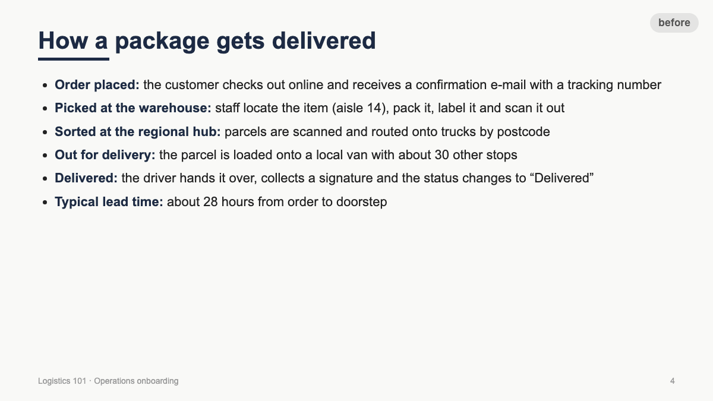
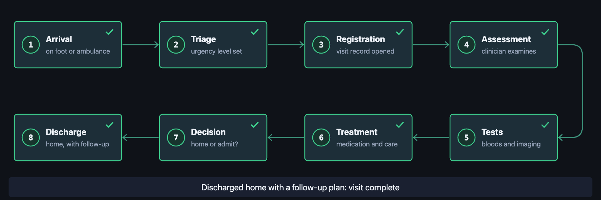
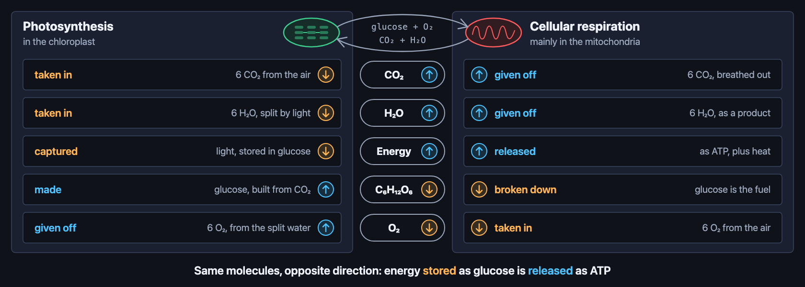
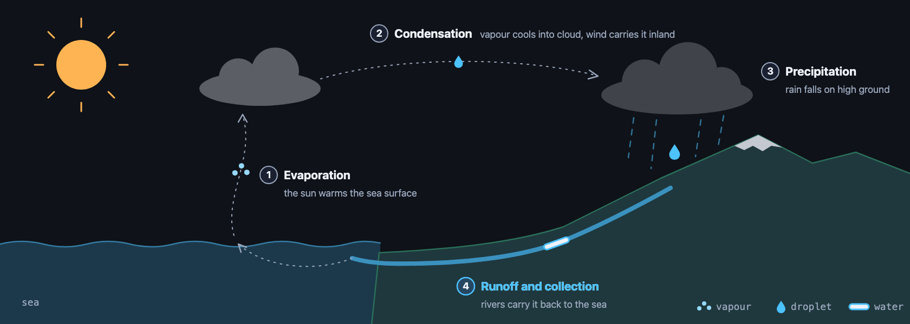
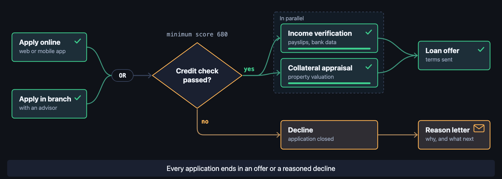
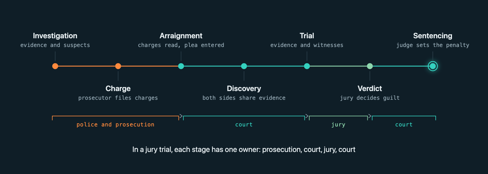
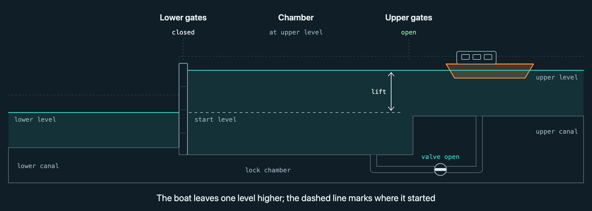
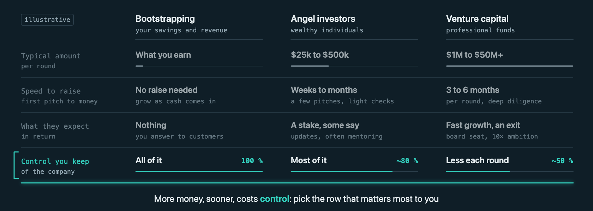
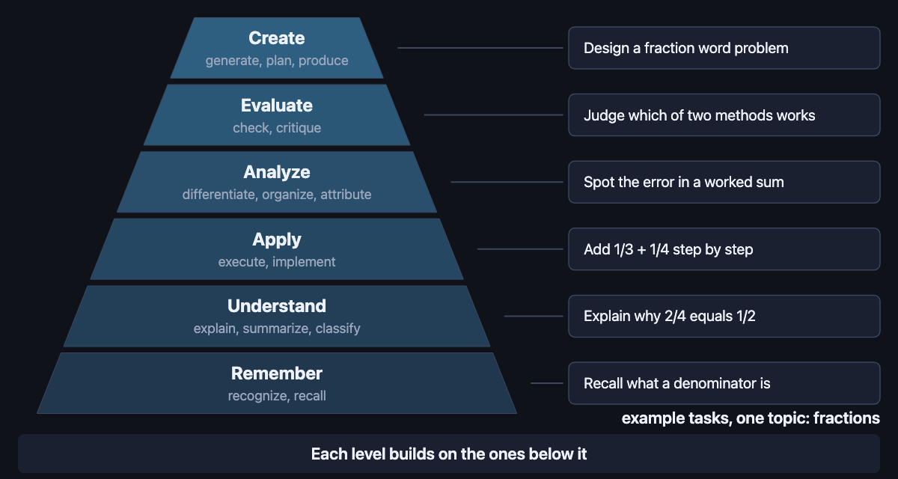
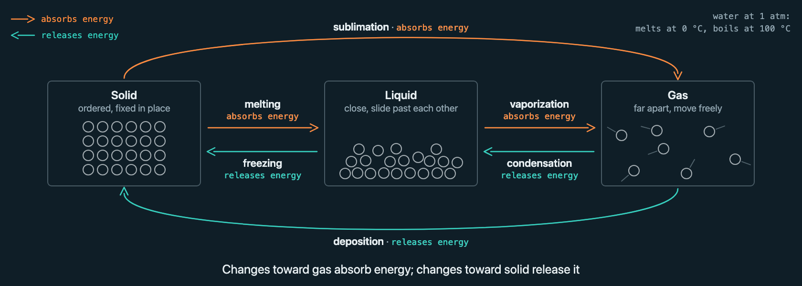

# anim-slides

[](https://github.com/KehanLiu/anim-slides/actions/workflows/ci.yml)
[](https://kehanliu.github.io/anim-slides/)
[](https://agentskills.io)
[](LICENSE)

**Turn boring bullet slides into animated diagrams, with the coding agent you already use.**



```bash
npx skills add KehanLiu/anim-slides     # then ask your agent: "animate slide 4 of deck.pptx"
```

An agent skill that turns boring slides into animation-rich HTML, and turns written processes
and dependencies into animated diagrams. It uses the open
[Agent Skills](https://agentskills.io) format, so the same folder works in Claude Code, Codex,
Cursor, GitHub Copilot, Gemini CLI and Antigravity, OpenCode, Amp, Cline, Roo Code, Kiro,
Factory Droid, Zed, Goose and Devin Desktop.

Give it a PowerPoint, an HTML deck, or a document that describes a pipeline, a dependency
graph, a timeline, a state machine, a comparison or an architecture. It finds the slides worth
illustrating, writes a spec and a brief for each, builds a self-contained animated SVG
fragment, renders phase frames with headless Chrome and looks at them, and inlines the result
into your deck.

It animates figures; it does not design decks. **Deck first:** a PowerPoint or Markdown source
is turned into a designed HTML deck by a deck skill (your own, or e.g. `frontend-slides`)
before anim-slides adds the figures. `scripts/md_to_deck.py` is only a fallback host for when
no deck skill is installed: it makes a plain HTML deck to integrate into, not a design.

## Pool

The skill ships a pool of 22 finished, checked fragments across 16 fields, at least one per
archetype. The agent starts from the closest one before building from scratch. See them all
animating in the **[live gallery](https://kehanliu.github.io/anim-slides/)**. Resting frames:

<table>
<tr>
<td><br><code>er-patient-flow</code></td>
<td><br><code>photosynth-respiration</code></td>
<td><br><code>water-cycle</code></td>
</tr>
<tr>
<td><br><code>loan-decision</code></td>
<td><br><code>court-case</code></td>
<td><br><code>canal-lock</code></td>
</tr>
<tr>
<td><br><code>funding-options</code></td>
<td><br><code>bloom-taxonomy</code></td>
<td><br><code>phase-changes</code></td>
</tr>
</table>

More in [`pool/README.md`](pool/README.md), including how to keep a private pool of your own.

## What you get

Each illustration is one **fragment**: a `<style>` plus one inline `<svg>` in a single HTML file.

- **Drop-in.** Works in reveal.js, impress.js, Slidev, frontend-slides decks, hand-written HTML
  and plain scrolling pages. No framework, no build tool, no dependency.
- **Lean by default.** Rings and thin lines on a quiet dark ground, one accent that lights the
  active step, mono sub-labels, no boxes. `references/style.md` is the guide; the scaffolder
  emits it.
- **Themed by variables.** Fragments read `--anim-theme-*` CSS variables and carry neutral
  fallbacks, so one `:root` rule rethemes every illustration to your brand.
- **Match or lean.** At intake the skill settles one look per deck: *match* keeps your deck's
  palette and fonts (`scripts/host_theme.py` derives the rule from the deck's CSS), *lean*
  puts the illustrations on their own dark ground. Shapes stay lean either way: a branded
  deck gets rings and lines in its own blue, not its cards redrawn.
- **Safe to paste.** Every class, id and keyframe is prefixed, so nothing collides with the deck's
  own CSS.
- **Plays once, when shown.** A fragment plays one calm pass (4 to 10 s) when its slide becomes
  current and ends on the resting frame, which is the finished state; nothing loops or pulses
  while you talk, and PDF export and reduced-motion users get a complete still.
- **Three control modes, one CSS fragment.** `once` (default) plays the pass when the slide appears;
  `step` plays the same fragment in phases, the entrance with the slide and each click landing
  the next phase, through a small host script with no library; `loop` for kiosks and
  galleries. Once is the default for the whole deck; ask for step if you want to click
  through the phases.
- **Less by rule.** The fragment is the slide's own figure in its own form plus one movement.
  The checker measures how many things move and how many glow at the same instant, so "too much" fails before you see it.
- **Shareable.** The skill adds no CDN or network loads, and `bundle_deck.py` turns the deck
  into one self-contained HTML file for sharing, verified by `check_page.py`.
- **Verified by looking.** The skill renders phases of the pass to PNG and inspects them before
  it calls anything done.

## Install

The skill is one folder (`SKILL.md`, `references/`, `scripts/`, `pool/`). Any harness that
reads the Agent Skills format picks it up from its skills directory; the folder name must stay
`anim-slides`.

### Option A: the `skills` installer (any harness)

[`skills`](https://github.com/vercel-labs/skills) detects the agents on your machine, keeps one
copy in `.agents/skills/anim-slides` (or `~/.agents/skills/` with `-g`) and links each agent's
own folder to it. Needs Node.js 22.20+.

```bash
npx skills add KehanLiu/anim-slides              # this project, agents detected on your machine
npx skills add KehanLiu/anim-slides -g -y        # for your user, all detected agents, no prompts
npx skills add KehanLiu/anim-slides -g -a codex cursor github-copilot -y   # chosen agents only
npx skills add KehanLiu/anim-slides --list       # show what would be installed
```

Amp has its own equivalent: `amp skill add KehanLiu/anim-slides` (`--global` for your user).
Gemini CLI: `gemini skills install https://github.com/KehanLiu/anim-slides --scope user`.

### Option B: clone into a skills folder

```bash
git clone https://github.com/KehanLiu/anim-slides <skills-dir>/anim-slides
```

`<skills-dir>` per harness (project path, then user path). A symlink to a clone elsewhere works
everywhere except inside a Claude Code plugin.

| Harness | Project | User |
|---|---|---|
| Codex, Cursor, Copilot, OpenCode, Amp, Roo Code, Droid, Zed, Goose, Devin Desktop, Antigravity (project) | `.agents/skills/` | `~/.agents/skills/` |
| Claude Code | `.claude/skills/` | `~/.claude/skills/` |
| Cursor (own folder) | `.cursor/skills/` | `~/.cursor/skills/` |
| GitHub Copilot (own folder) | `.github/skills/` | `~/.copilot/skills/` |
| Gemini CLI | `.gemini/skills/` or `.agents/skills/` | `~/.gemini/skills/` |
| Antigravity (user) | `.agents/skills/` | `~/.gemini/config/skills/` |
| OpenCode (own folder) | `.opencode/skills/` | `~/.config/opencode/skills/` |
| Cline | `.cline/skills/` | `~/.cline/skills/` |
| Kiro | `.kiro/skills/` | `~/.kiro/skills/` |
| Factory Droid (own folder) | `.factory/skills/` | `~/.factory/skills/` |
| Devin Desktop (own folder) | `.devin/skills/` | `~/.config/devin/skills/` |

Most of these also read `.claude/skills/`, so a single clone there often serves several tools.
Install one way per machine: two copies with the same name shadow each other.

### Option C: Claude Code plugin (the repo is its own marketplace)

```bash
claude plugin marketplace add KehanLiu/anim-slides
claude plugin install anim-slides@anim-slides-marketplace
```

or `/plugin marketplace add KehanLiu/anim-slides` then `/plugin install anim-slides@anim-slides-marketplace`
inside a session. Installed this way the skill is invoked as `/anim-slides:anim-slides`.
Update with `claude plugin marketplace update anim-slides-marketplace` and
`claude plugin update anim-slides@anim-slides-marketplace` (auto-update is off for third-party
marketplaces). For a one-off trial from a local clone: `claude --plugin-dir ./anim-slides`.

### Requirements for the scripts

Python 3.9+ and a Chrome or Chromium binary (for phase rendering). Optional: `pyyaml` for full
YAML in specs (a built-in reader covers plain specs like the pool's, and JSON always works).
PowerPoint is read with the standard library; legacy `.ppt` needs one `soffice --headless
--convert-to pptx` first. The harness must
be able to run shell commands and view PNG files; the scripts are called by their path inside the
skill folder, which Claude Code exposes as `$CLAUDE_SKILL_DIR` and other harnesses report when
they load the skill.

## Use

With the skill installed, ask your agent in plain words:

- "Make the pipeline slide in `deck.html` an animated illustration."
- "Convert `talk.pptx` to HTML with frontend-slides, then animate the process and architecture slides."
- "Here is our release procedure (paste). Turn it into an animated diagram for slide 7."
- "Animate this Mermaid flowchart for a 1200x600 slot."

The skill works in three phases, in the spirit of "show, don't tell":

1. **Show first, ask once.** It outlines and renders your deck, drafts a triage table (which
   slides get a figure and why), builds and renders the first figure, and then asks one
   question with everything in it: the proposal, stills of that figure in your deck's look and
   in the lean dark look, play-once or click-through, and whether the file will be shared. For
   a PowerPoint it also says that an HTML deck has to be built first, what that costs, and
   offers standalone animated slide pages as a lighter path. No answer means sensible defaults,
   written down in `anim/triage.md`.
2. **Build silently.** The remaining figures, checked for contract, legibility and accuracy,
   inlined into the deck.
3. **Deliver by showing.** A before/after review page of every animated slide, the deck, and
   two one-line switches for later (click-through, lean look).

"Improve the slides" and "add more animations" mean the same to the skill: figures replace
text blocks and screenshots; nothing else about the deck changes.
Harnesses pick it up automatically from its description; to call it by name use `/anim-slides`
(Claude Code, Cursor, Copilot, Kiro, Droid, Antigravity, Devin Desktop), `$anim-slides` (Codex),
or ask for it by name where the agent loads skills through a tool (OpenCode, Zed, Goose, Gemini
CLI).

### Scripts you can also run yourself

```bash
# outline a deck with archetype suggestions per slide
python3 scripts/extract_slides.py deck.pptx -o anim/outline.json

# spec -> skeleton fragment
python3 scripts/scaffold_from_spec.py anim/deploy/spec.yaml -o anim/deploy/deploy.html

# contract checks (prefixes, tokens, gating, text size at rendered width)
python3 scripts/check_fragment.py anim/deploy/deploy.html --name deploy --rendered-width 1200 --stage-width 1920

# phase frames at 1.5 s, 4 s, 7 s, 10 s plus the resting frame, and a contact sheet (temp dir)
scripts/render-phases.sh anim/deploy 1200 600 1.5 4 7 10 rest

# resting frame of the finished host page (what PDF export shows)
scripts/render-phases.sh --page deck.html 1920 1080 rest

# inline into a deck: markup goes between <!-- anim:NAME:start --> / <!-- anim:NAME:end -->,
# style into the head between <!-- anim-style:NAME:start --> / <!-- anim-style:NAME:end -->;
# re-runs replace both blocks, --dry-run prints a summary without writing
python3 scripts/integrate_fragment.py deck.html anim/deploy/deploy.html --name deploy \
  --anchor '<section id="release">' --gate section.present --backup
```

## How it works

```
deck.pptx / deck.html / docs.md / mermaid
        │  extract_slides.py + triage         (references/input-stage.md)
        ▼
  spec.yaml   nodes, edges, groups, phases     (references/spec-format.md)
        │  scaffold_from_spec.py + archetype recipe (references/archetypes.md)
        ▼
  <name>.html  one fragment, CSS keyframes    (references/fragment-contract.md)
        │  check_fragment.py, render-phases.sh, look at the PNGs
        ▼
  deck.html    integrate_fragment.py, gate rewritten for the host
```

## Accuracy

A fragment adds motion, not facts. The skill is built to keep it that way:

- **Figures are redrawn, never dropped.** A chart, graph, table or scientific figure on the
  source slide is rebuilt from its data at exact scale and animated; only photos and decoration
  may go.
- **Every number is traced.** `scripts/verify_facts.py` compares a fragment's visible text and
  numbers with the source slide (title, bullets, notes, tables): an invented number, date or
  ratio fails the build, untraceable wording is listed for review, and facts pulled from a
  neighbouring slide are reported separately. Illustrative values must say so on the slide.
- **Source wording wins.** Labels use the slide's own words; "approved" stays "approved" and
  does not become "signed into law".
- **Checked on real decks.** The rules come from converting six openly licensed decks (CDC,
  NOAA, Lumen Learning, Sorbonne, SNAP) and auditing every rebuilt slide against its original.

`references/accuracy.md` has the full rules and a checklist for briefs.

## Theming

```css
:root {
  --anim-theme-bg: #0F1E27;  --anim-theme-panel: #0D1820;  --anim-theme-line: #2A3D49;
  --anim-theme-fg: #E6EDF0;  --anim-theme-muted: #93A7B2;
  --anim-theme-accent: #34D1BF;  --anim-theme-accent-2: #FF8A3D;
  --anim-theme-ok: #8ED7AD;  --anim-theme-warn: #FFD15C;  --anim-theme-danger: #FF6B6B;
  --anim-theme-font: system-ui, sans-serif;  --anim-theme-mono: ui-monospace, monospace;
}
```

These values equal the built-in fallbacks, so a host only overrides what differs.
`python3 scripts/host_theme.py deck.html --mode match` reads a deck's CSS variables and most
used colours and prints this block filled with the deck's own values (`--apply deck.html`
inserts it between markers); `--mode lean` writes the lean palette scoped to a `.anim-lean`
slide class for decks that should keep their own look everywhere else.

## Repository layout

```
SKILL.md                 workflow and rules the agent follows (Agent Skills format)
agents/openai.yaml       optional Codex metadata; other harnesses ignore it
.claude-plugin/          marketplace manifest for the Claude Code plugin install
references/              contract, accuracy, spec format, archetypes, input stage, brief, layouts, motion rules, lessons
scripts/                 extract, scaffold, check, verify facts, render, integrate, check page, bundle, gallery; host snippets
pool/                    finished fragments, one or more per archetype, with thumbnails, specs and index.yaml
docs/                    design notes and history
```

## Background

This skill grew out of building about a dozen animated illustrations for a lecture deck, by
hand, in autumn 2026. The repeated loop (brief, build, render phases, look, fix, integrate) and
the gotchas it surfaced are written up in `docs/design-notes-2026-11-01.md`.

## Self-test

`evals/` holds trap decks (long German words, CJK labels, a faint light theme, a 4:3 stage, a
15-event timeline, a 20-node graph, a chart that is only a picture, icon columns, an already
animated deck) with graders, in the format `claude plugin eval` reads. Run
`claude plugin eval . --allow-tools Write,Edit,Bash --scaffold` from the skill folder (billed;
`--runs 1` for a quick pass), or run one case by hand as `evals/README.md` describes. Inside a
run the skill checks itself twice: `scripts/check_look.py` measures the rendered figure
(clipping, overlap, contrast, boxes, colours, density), and a fresh reviewer that sees only the
before/after images scores it with `references/look-rubric.md` before "done".

## License

MIT, see `LICENSE`.
