# Pool

Finished fragments that satisfy `references/fragment-contract.md`, at least one per archetype, across a dozen fields (health, finance, biology, law, earth science, logistics, software and more).
The agent checks here before building from scratch (SKILL.md, step 1b): a close match is
adapted (relabel, re-time, retheme), anything else still serves as the quality bar for density,
timing and legibility. `index.yaml` lists every entry with its archetype, size, cycle, story and
tags.

Each folder is `pool/<name>/`: the fragment `<name>.html`, `thumb.png` (its resting frame) and,
where the fragment came from the scaffolder, `spec.yaml`. Most fragments were polished by hand
after scaffolding, so the spec reproduces the structure and timing, not every detail.

| | Name | Archetype | Domain | viewBox | Cycle | Story |
|---|---|---|---|---|---|---|
| 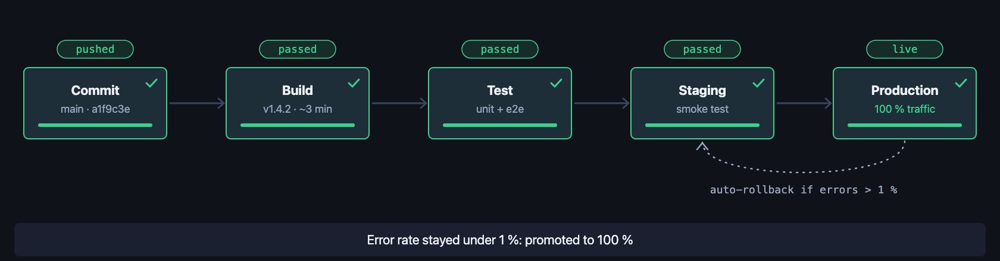 | `deploy-pipeline` | pipeline | software | 1680×440 | 9.8 s | A commit moves through build, test and staging, then a 5 % canary earns 100 % of traffic while an auto-rollback edge stands by. |
| 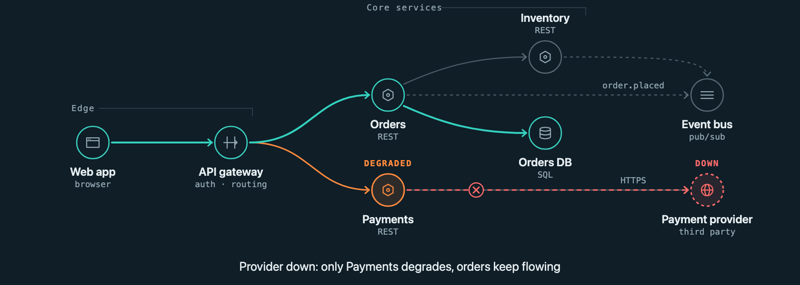 | `service-deps` | graph | software | 1680×600 | 9.8 s | A service graph builds rank by rank, one request is traced through it, then a third-party outage stays contained to Payments. |
| 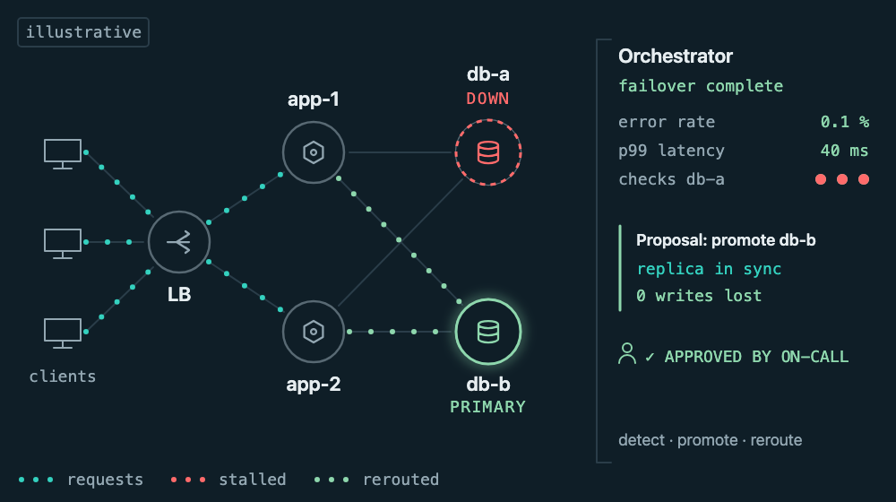 | `db-failover` | graph | software | 1000×560 | 9.4 s | Requests reach the primary database, it fails, health checks propose promoting the replica, on-call approves and traffic is rerouted. |
| 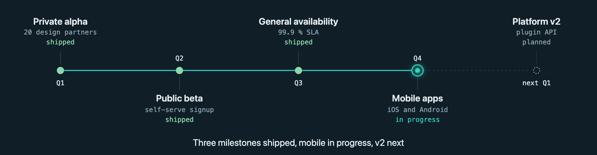 | `roadmap` | timeline | product | 1680×440 | 9.9 s | Three milestones ship one after another, mobile apps are in progress and platform v2 is planned. |
| 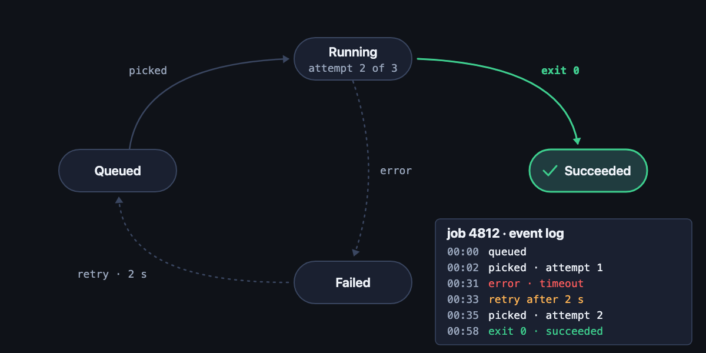 | `job-states` | states | software | 1200×600 | 9.8 s | A job is picked, fails with a timeout, retries after a backoff and succeeds on the second attempt, with an event log filling in. |
| 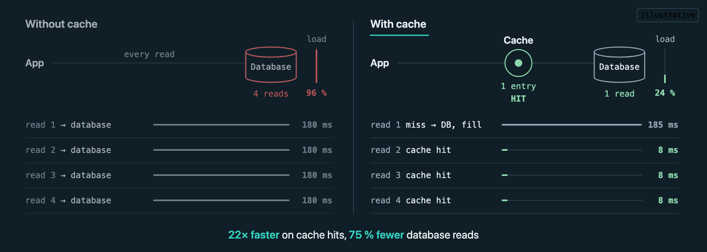 | `cache-compare` | compare | software | 1680×600 | 10 s | The same four reads without and with a cache; repeated 180 ms database reads become 8 ms hits and database load drops. |
| 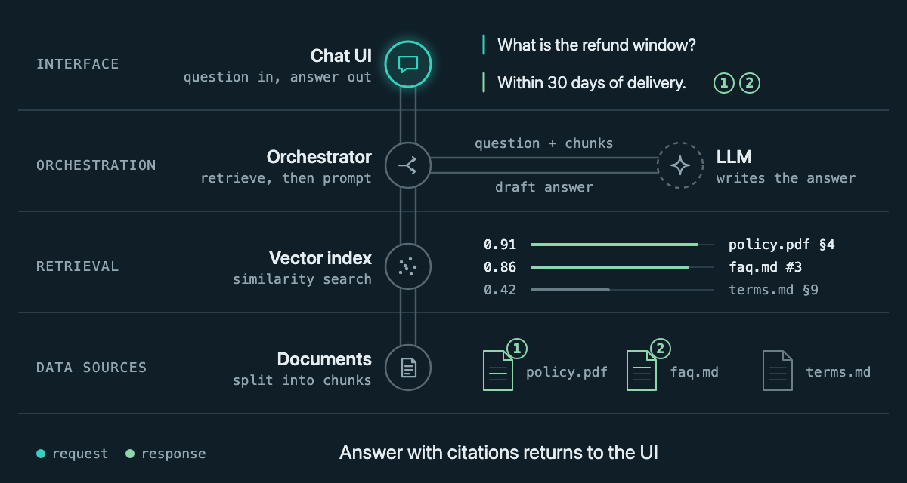 | `rag-stack` | layers | ai | 1200×640 | 9.8 s | One question travels down a four-layer RAG stack, matching chunks come back up, the LLM drafts an answer and it returns with citations. |
| 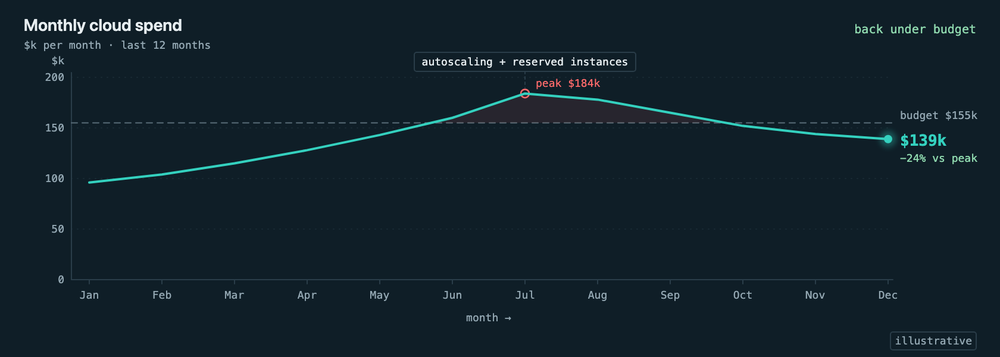 | `cloud-spend` | chart | finance | 1680×600 | 9.5 s | A line chart draws on as monthly spend climbs past a budget line, then bends back under it after an autoscaling event. |
| 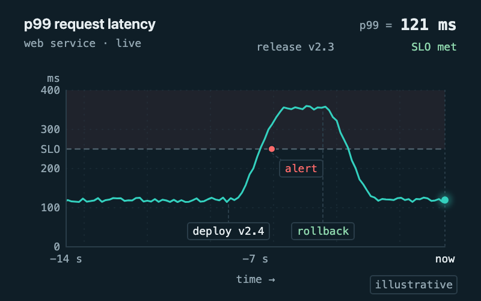 | `latency-trace` | chart | software | 800×500 | 10 s | A scrolling strip chart of p99 latency; a deploy spikes it over the SLO line, an alert fires and a rollback brings it back. |
| 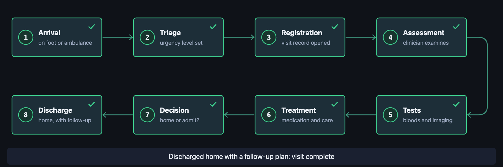 | `er-patient-flow` | pipeline | health | 1680×560 | 10 s | An emergency department visit in eight numbered steps wrapped into two rows, from arrival and triage to the decision and discharge. |
| 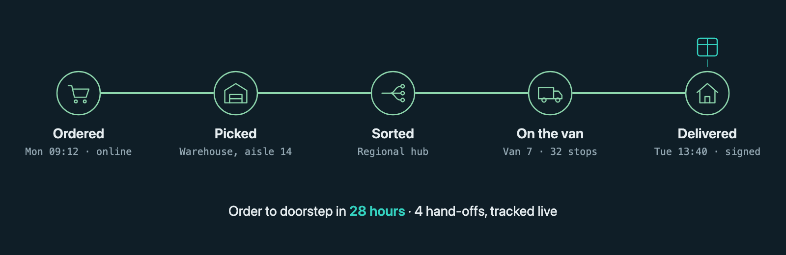 | `parcel-route` | pipeline | logistics | 1600×520 | 7.5 s | A parcel hops through five stations from order to doorstep, each turning green when passed, ending on the 28-hour lead time. |
| 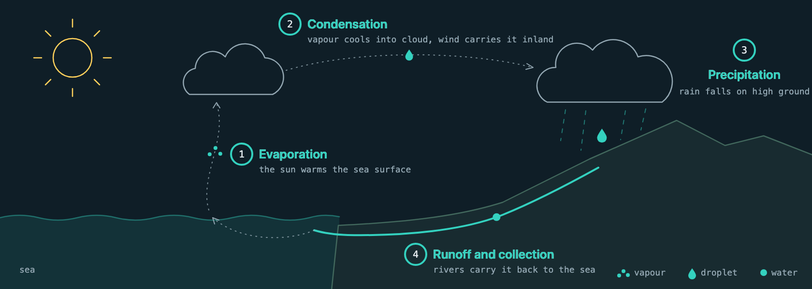 | `water-cycle` | pipeline | earth-science | 1680×600 | 10 s | Over a sea-and-mountain landscape the sun evaporates water, wind carries the cloud inland, rain falls and a river returns it to the sea. |
| 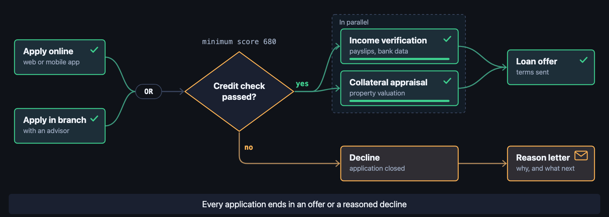 | `loan-decision` | graph | finance | 1680×600 | 10 s | Online OR branch applications meet a credit-check diamond; yes runs two checks in parallel to an offer, no ends in a decline with a reason letter. |
| 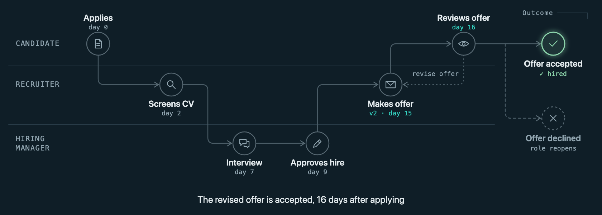 | `hiring-lanes` | graph | hr | 1680×600 | 10 s | Swimlanes for candidate, recruiter and hiring manager; one token is handed between lanes, a revise-offer loop runs once and the offer is accepted. |
| 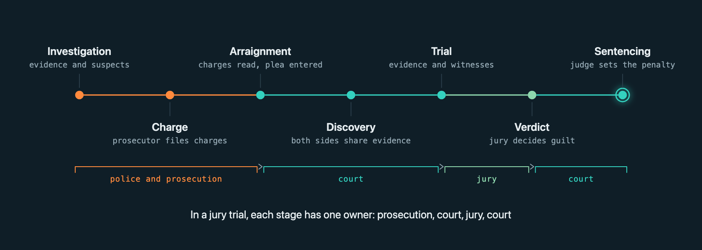 | `court-case` | timeline | law | 1680×600 | 10 s | A generic criminal case from investigation to sentencing; the progress line changes colour at each hand-off between prosecution, court and jury. |
| 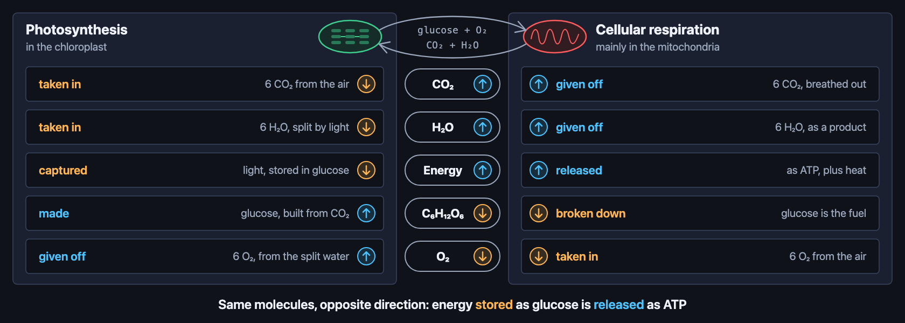 | `photosynth-respiration` | compare | biology | 1680×600 | 10 s | Photosynthesis and cellular respiration side by side; as each respiration row enters, its direction badge flips to the opposite of photosynthesis. |
| 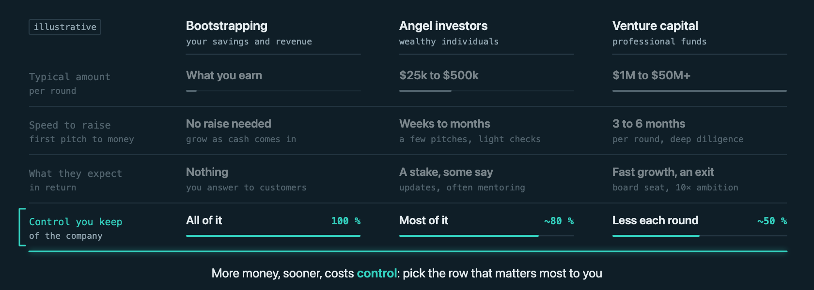 | `funding-options` | compare | business | 1680×600 | 9 s | Bootstrapping, angel investors and venture capital built column by column across four criteria, ending on the control-you-keep row. |
| 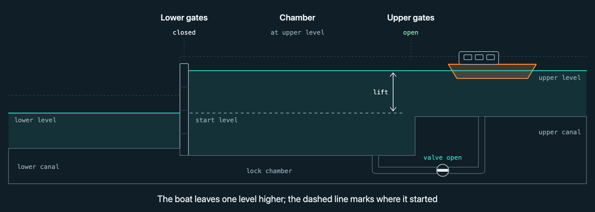 | `canal-lock` | states | engineering | 1680×600 | 9.5 s | A side cross-section of a canal lock: the boat enters, the lower gates close, the valve fills the chamber, the upper gates open and the boat leaves higher. |
| 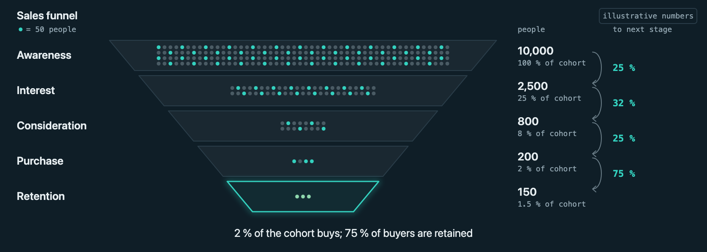 | `sales-funnel` | pipeline | marketing | 1680×600 | 9.6 s | One cohort of 10,000 thins out through awareness, interest, consideration and purchase to retention; every conversion matches the counts and the numbers are marked illustrative. |
| 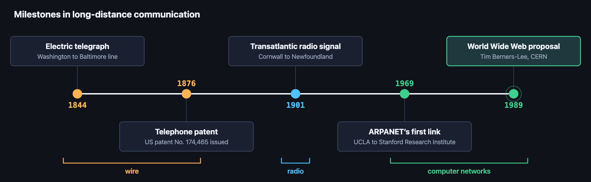 | `comms-timeline` | timeline | history | 1680×520 | 8.6 s | Five milestones in long-distance communication, from the 1844 telegraph line to the 1989 Web proposal, advancing era by era with brackets for wire, radio and computer networks. |
| 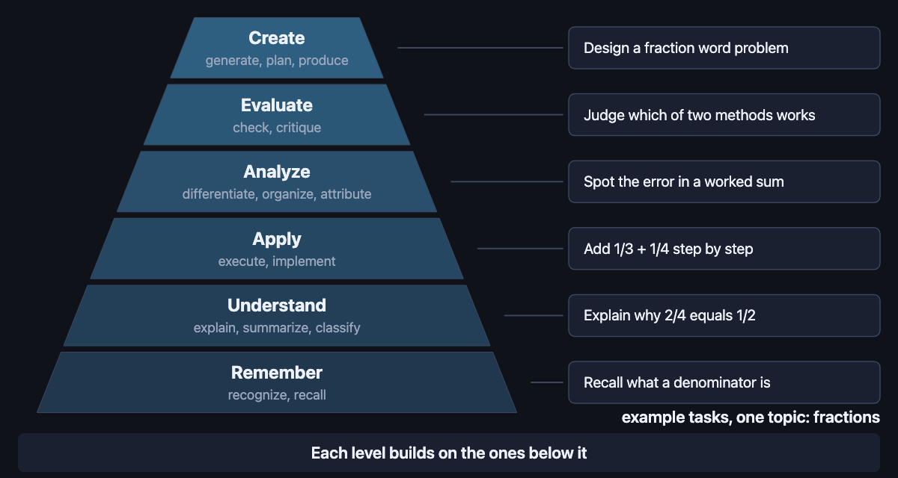 | `bloom-taxonomy` | layers | education | 1200×640 | 10 s | The six levels of the revised Bloom's taxonomy build bottom-up, then one topic (fractions) climbs from Remember to Create with an example task per level. |
| 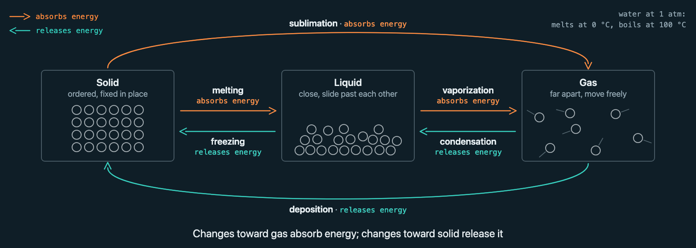 | `phase-changes` | states | chemistry | 1680×600 | 10 s | Solid, liquid and gas with their particles; a token runs all six phase changes, each labelled with whether it absorbs or releases energy, water's 0 °C and 100 °C at 1 atm noted. |

All are `data-anim-control="once"` (CSS only, no script): one pass of the length in the
Cycle column, played when the slide becomes current, ending on the resting frame. Without a
`.visible` ancestor, and under `prefers-reduced-motion`, each shows that resting frame: the
finished state of the story.

## Preview

`render-phases.sh` takes a fragment folder or file and writes PNGs to a temp folder it prints:

```sh
scripts/render-phases.sh pool/db-failover 1000 560 1.5 4 7 10 rest
```

Then open every `phase-*.png` and look at it. The generated `preview-*.html` files are paused
stills; for real motion drop the fragment into a page with a `.visible` ancestor (or use
`scripts/snippets/observer.html`) and open that in a browser.

## Scaffold from a spec

```sh
python3 scripts/scaffold_from_spec.py pool/deploy-pipeline/spec.yaml -o /tmp/anim/my-pipeline/my-pipeline.html
```

Rename `name:` in the spec first when you adapt it, so prefixes stay unique within the deck.

## Retheme

The fragments read only `--anim-*` tokens, which fall back to a neutral dark palette.
Set the `--anim-theme-*` variables once on `:root` (or on a slide) in the host page:

```css
:root {                          /* example: a light theme */
  --anim-theme-bg: #ffffff;       /* must match the slide background: label plates use it */
  --anim-theme-panel: #f2f4f8;
  --anim-theme-line: #c5ccd8;
  --anim-theme-fg: #14181f;
  --anim-theme-muted: #5b6474;
  --anim-theme-accent: #0a6cff;
  --anim-theme-accent-2: #d9480f;
  --anim-theme-ok: #2b8a3e;
  --anim-theme-warn: #e67700;
  --anim-theme-danger: #c92a2a;
  --anim-theme-font: 'Inter', system-ui, sans-serif;
  --anim-theme-mono: 'JetBrains Mono', ui-monospace, monospace;
}
```

Fills mixed from `--anim-bg` (label plates, tinted tags) assume it matches the slide
background; if `--anim-theme-bg` differs they show as faint boxes.

## Private pools

Fragments with work- or client-specific content do not belong here. Keep them in a folder of
your own with the same layout (`<name>/<name>.html`, optional `index.yaml`) and point
`ANIM_POOL` at it; the agent searches it after this pool.

## Contributing

A new entry needs: a domain-neutral story, a clean `check_fragment.py` run at the viewBox width,
phase renders you have looked at, `thumb.png` from the `rest` render, and a row in `index.yaml`
and in the table above.
