# Pool

Finished fragments that satisfy `references/fragment-contract.md`: one for each motion verb
(`references/motion-verbs.md`) and at least one per build family, across a dozen fields
(health, finance, biology, law, civics, earth science, education, logistics, software and
more). The agent checks here before building from scratch (SKILL.md, step 1b): a close match
is adapted (relabel, re-time, retheme), anything else still serves as the quality bar for
density, timing and legibility. The pool sets the floor for craft and is looked up by verb,
then form and moves; it is not the menu of pictures. `index.yaml` lists every entry with its
verb, archetype, form, moves, size, cycle, story and tags:

- `verb`: the entry's main motion, the one that is its claim: grow, accumulate, thin, race,
  split, merge, sort, stack, nest, transform, wipe, switch, balance, drive, zoom, open,
  travel, trace, cycle, or reveal for an order-only row. Look up the verb the slide's claim
  calls for first. At most a third of the pool uses a travelling marker (`travel`, and the
  one trip of a `cycle`); `scripts/check_verbs.py --pool pool/index.yaml` enforces it.
- `form`: the shape of the picture, one word from row, snake, axis, graph, flowchart, lanes,
  ring, matrix, table, columns, column, bands, nested, pyramid, funnel, line-chart,
  strip-chart, particles, scene. Look up the form the slide's picture idea calls for, not the
  archetype that names its logic. A `scene` marks its ground (water, land, a chamber wall)
  with `data-anim-scene`, so `check_look.py` does not count it as boxes behind labels.
- `moves`: the motion techniques the entry demonstrates, from level, count, accumulate,
  dots-at-scale, units-sort, race-bars, trajectory, split-merge, ghost-before-after, rotate,
  drive-chain, clip-reveal, wipe, cutaway, zoom, morph, nest-outline, state-switch, mark,
  thinning, stacking, colour-scale, token-changes-type, cross-fade-shape, packet-hop,
  draw-on. Open an entry for a move even when its form differs.

Each folder is `pool/<name>/`: the fragment `<name>.html`, `thumb.png` (its resting frame) and,
where the fragment came from the scaffolder, `spec.yaml`. Most fragments were polished by hand
after scaffolding, so the spec reproduces the structure and timing, not every detail.

| | Name | Verb | Archetype | Form | Domain | viewBox | Cycle | Story |
|---|---|---|---|---|---|---|---|---|
| 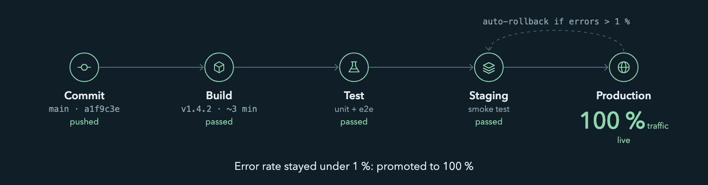 | `deploy-pipeline` | travel | pipeline | row | software | 1680×440 | 9.8 s | A commit moves through build, test and staging, then a 5 % canary earns 100 % of traffic while an auto-rollback edge stands by. |
| 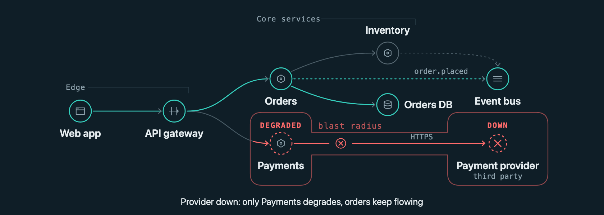 | `service-deps` | nest | graph | graph | software | 1680×600 | 9.4 s | A service graph builds rank by rank, then a third-party outage spreads only to Payments and a boundary closes around the two: the blast radius. |
| 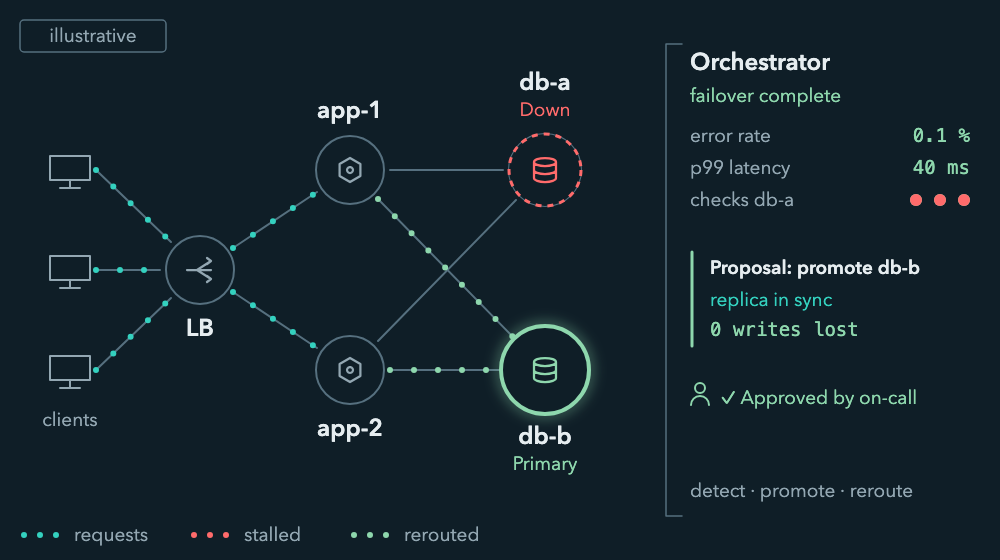 | `db-failover` | travel | graph | graph | software | 1000×560 | 9.4 s | Requests reach the primary database, it fails, health checks propose promoting the replica, on-call approves and traffic is rerouted. |
| 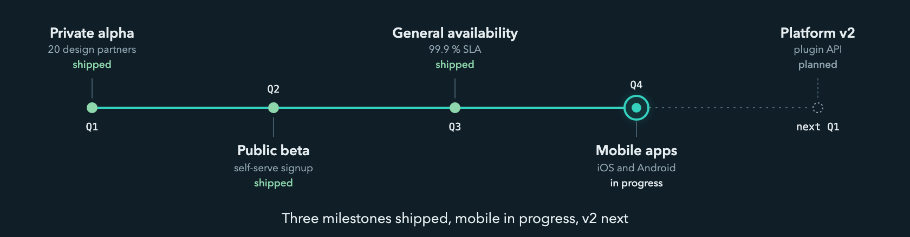 | `roadmap` | reveal | timeline | axis | product | 1680×440 | 9.9 s | Three milestones ship one after another, mobile apps are in progress and platform v2 is planned. |
| 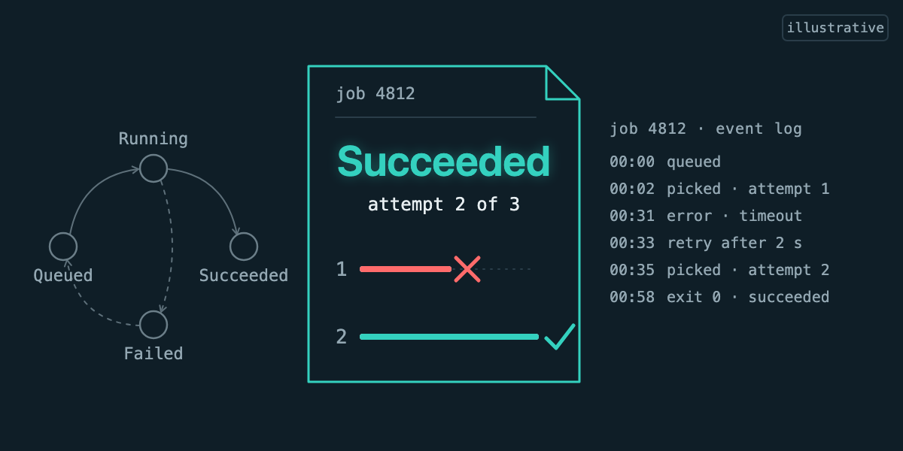 | `job-states` | ? | states | ring | software | 1200×600 | 9.8 s | A job is picked, fails with a timeout, retries after a backoff and succeeds on the second attempt, with an event log filling in. |
| 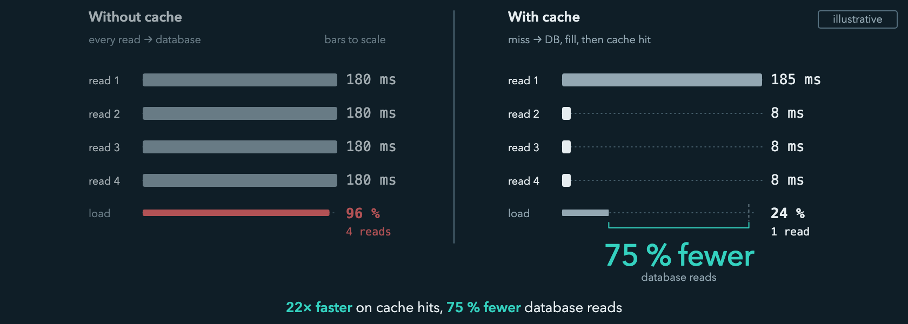 | `cache-compare` | race | compare | columns | software | 1680×600 | 10 s | The same four reads raced on one clock without and with a cache; 180 ms database reads keep growing while 8 ms hits stop almost at once, and database load climbs to 96 % on one side but stays at 24 % on the other. |
| 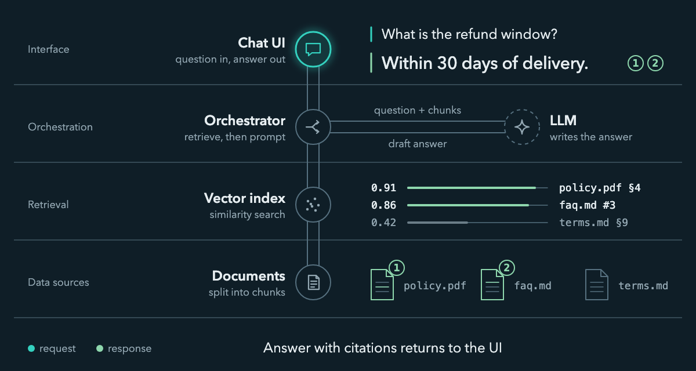 | `rag-stack` | travel | layers | bands | ai | 1200×640 | 9.8 s | One question travels down a four-layer RAG stack, matching chunks come back up, the LLM drafts an answer and it returns with citations. |
| 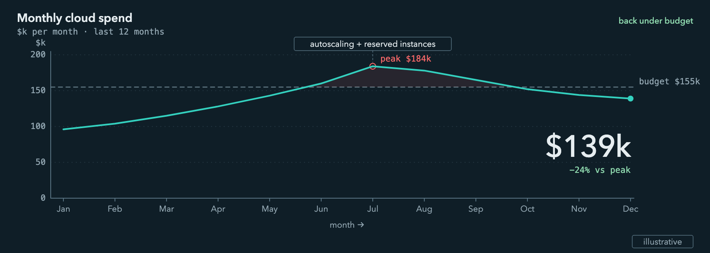 | `cloud-spend` | trace | chart | line-chart | finance | 1680×600 | 9.5 s | A line chart draws on as monthly spend climbs past a budget line, then bends back under it after an autoscaling event. |
| 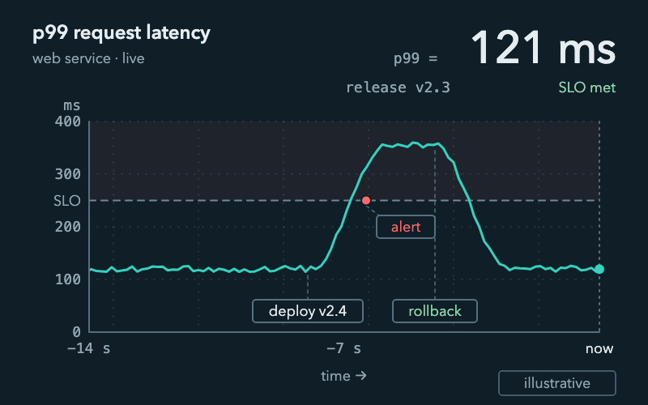 | `latency-trace` | trace | chart | strip-chart | software | 800×500 | 10 s | A scrolling strip chart of p99 latency; a deploy spikes it over the SLO line, an alert fires and a rollback brings it back. |
| 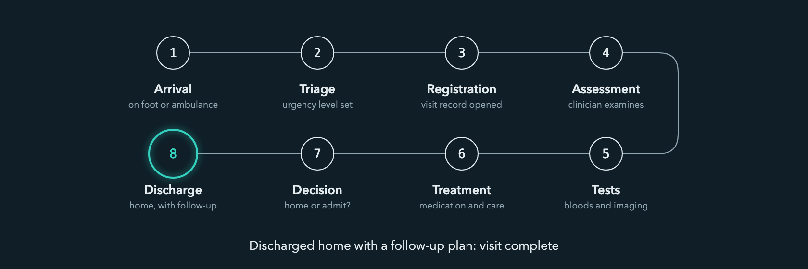 | `er-patient-flow` | travel | pipeline | snake | health | 1680×560 | 10 s | An emergency department visit in eight numbered steps wrapped into two rows, from arrival and triage to the decision and discharge. |
| 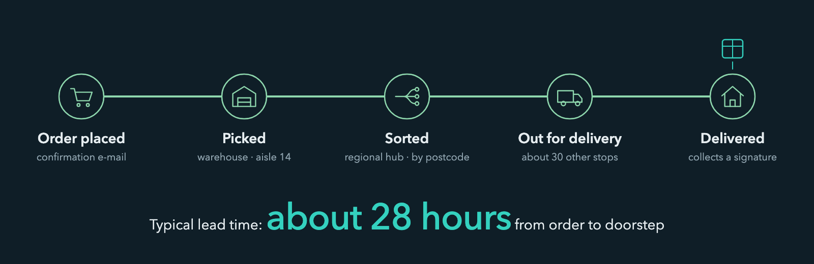 | `parcel-route` | travel | pipeline | row | logistics | 1600×520 | 7.5 s | A parcel hops through five stations from order to doorstep, each turning green when passed, ending on the 28-hour lead time. |
| 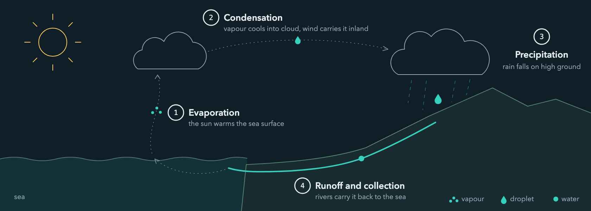 | `water-cycle` | cycle | pipeline | scene | earth-science | 1680×600 | 10 s | Over a sea-and-mountain landscape the sun evaporates water, wind carries the cloud inland, rain falls and a river returns it to the sea. |
| 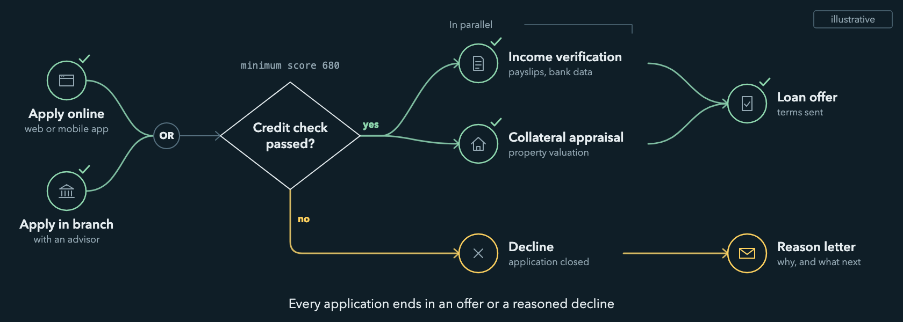 | `loan-decision` | travel | graph | flowchart | finance | 1680×600 | 10 s | Online OR branch applications meet a credit-check diamond; yes runs two checks in parallel to an offer, no ends in a decline with a reason letter. |
| 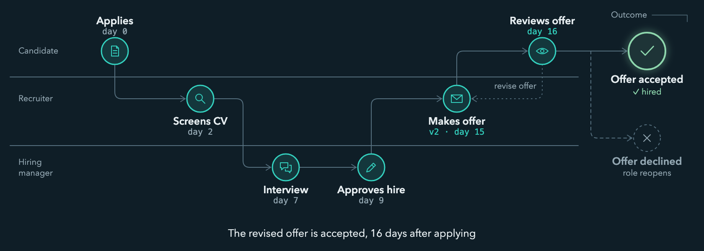 | `hiring-lanes` | travel | graph | lanes | hr | 1680×600 | 10 s | Swimlanes for candidate, recruiter and hiring manager; one token is handed between lanes, a revise-offer loop runs once and the offer is accepted. |
| 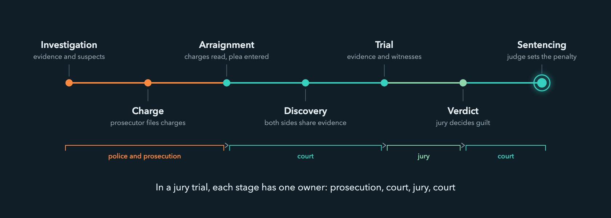 | `court-case` | reveal | timeline | axis | law | 1680×600 | 10 s | A generic criminal case from investigation to sentencing; the progress line changes colour at each hand-off between prosecution, court and jury. |
| 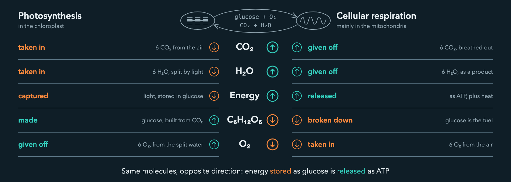 | `photosynth-respiration` | switch | compare | table | biology | 1680×600 | 10 s | Photosynthesis and cellular respiration side by side; as each respiration row enters, its direction badge flips to the opposite of photosynthesis. |
| 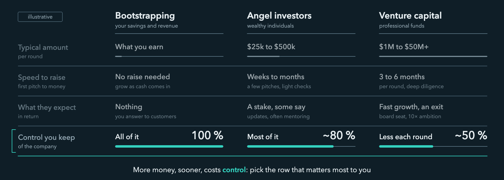 | `funding-options` | reveal | compare | matrix | business | 1680×600 | 9 s | Bootstrapping, angel investors and venture capital built column by column across four criteria, ending on the control-you-keep row. |
| 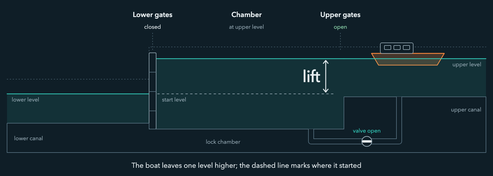 | `canal-lock` | grow | states | scene | engineering | 1680×600 | 9.5 s | A side cross-section of a canal lock: the boat enters, the lower gates close, the valve fills the chamber, the upper gates open and the boat leaves higher. |
| 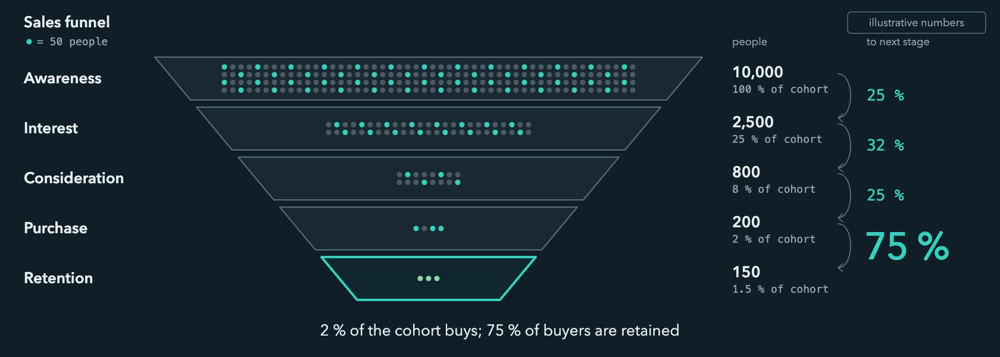 | `sales-funnel` | thin | pipeline | funnel | marketing | 1680×600 | 9.6 s | One cohort of 10,000 thins out through awareness, interest, consideration and purchase to retention; every conversion matches the counts and the numbers are marked illustrative. |
| 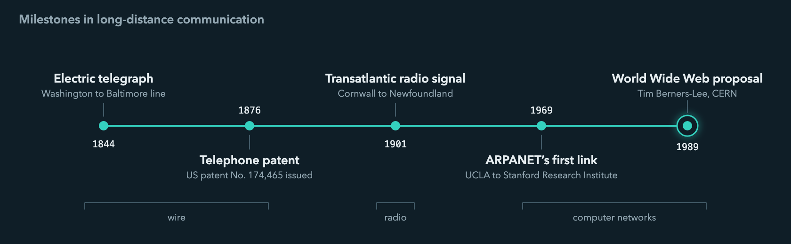 | `comms-timeline` | reveal | timeline | axis | history | 1680×520 | 8.6 s | Five milestones in long-distance communication, from the 1844 telegraph line to the 1989 Web proposal, advancing era by era with brackets for wire, radio and computer networks. |
| 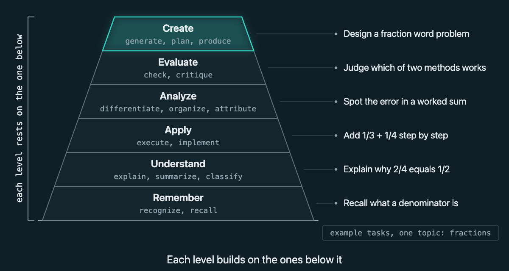 | `bloom-taxonomy` | stack | layers | pyramid | education | 1200×640 | 10 s | The six levels of the revised Bloom's taxonomy are set on top of one another bottom-up, each resting on the one below, and one topic (fractions) gets an example task at every level. |
| 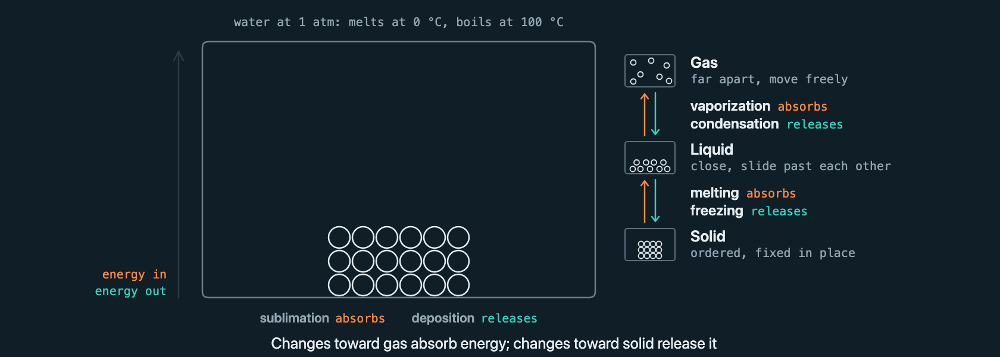 | `phase-changes` | ? | states | particles | chemistry | 1680×600 | 10 s | Solid, liquid and gas with their particles; a token runs all six phase changes, each labelled with whether it absorbs or releases energy, water's 0 °C and 100 °C at 1 atm noted. |
| 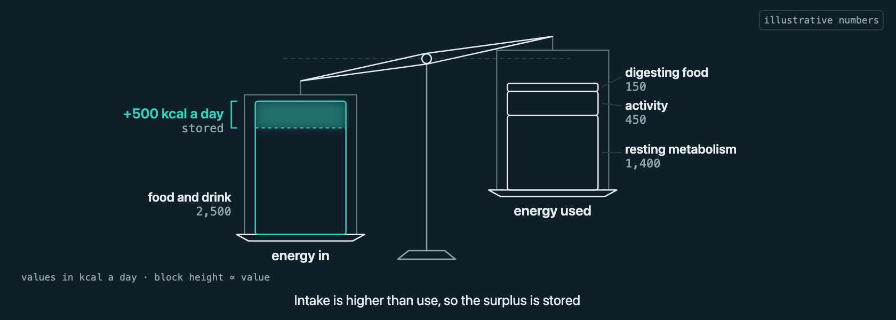 | `energy-balance` | balance | compare | scene | health | 1680×600 | 9.6 s | A beam balance starts level and empty; resting metabolism, activity and digesting food land on the energy-used pan and the beam dips right with each, then food and drink lands on the energy-in pan and the beam swings past level to the intake side, marking a 500 kcal a day surplus as stored (illustrative numbers). |
| 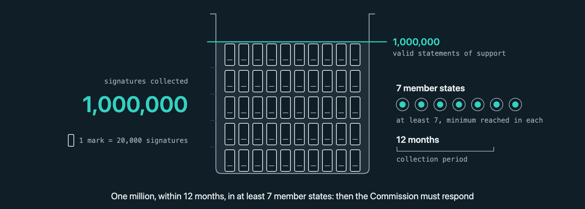 | `petition-threshold` | accumulate | chart | column | civics | 1680×600 | 9 s | A European Citizens' Initiative fills a column with signature marks (1 mark = 20,000) in three waves until it reaches the 1,000,000 line; then seven member-state markers tick on next to a 12-month bracket. |
| 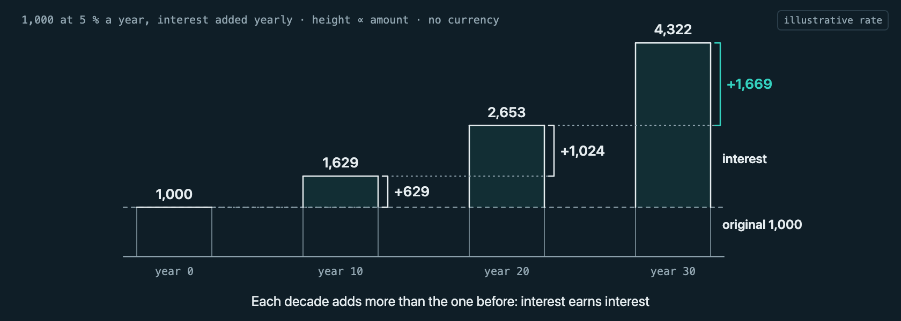 | `compound-interest` | grow | chart | columns | finance | 1680×600 | 9.6 s | Left alone at an example rate of 5 % a year, 1,000 grows to 1,629, 2,653 and 4,322 at years 10, 20 and 30, and each decade adds more than the one before (+629, +1,024, +1,669). |
| 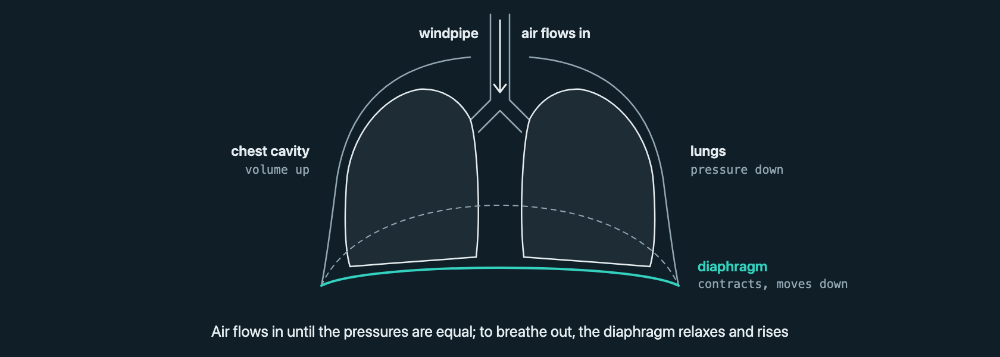 | `breathing` | drive | states | scene | health | 1680×600 | 8.6 s | A front cross-section of the chest; the domed diaphragm contracts and flattens, the lungs follow it down, then volume up, pressure down and air flows in down the windpipe, resting on the inhaled state with the resting dome kept as a dashed ghost. |
| 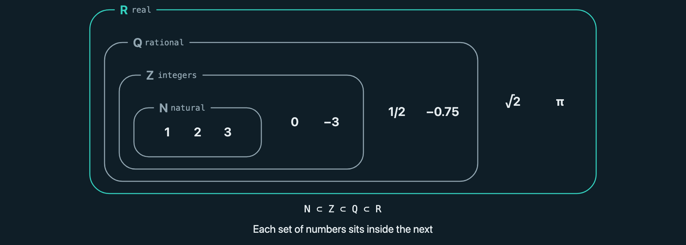 | `number-sets` | nest | layers | nested | education | 1680×600 | 9.9 s | The natural numbers 1, 2, 3 get an outline, then 0 and -3, 1/2 and -0.75, and the square root of 2 and pi arrive just outside, and each time a larger outline draws around everything so far, giving N in Z in Q in R. |
| 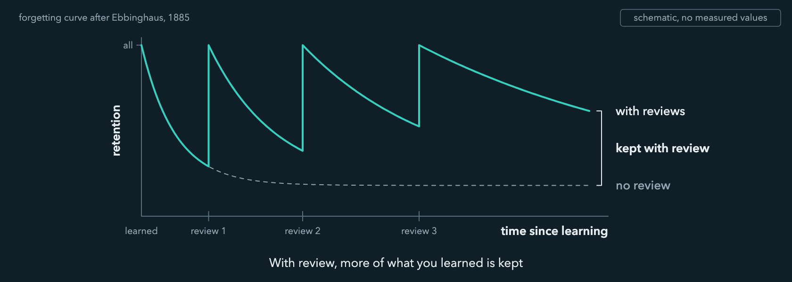 | `forgetting-curve` | trace | chart | line-chart | education | 1680×600 | 10 s | Without review, what you learned fades fast and levels off as a dashed ghost; the review line traces on, jumps back to the top at three reviews and falls less steeply each time, and a bracket marks what is kept with review (schematic). |
|  | `contract-formation` | switch | states | scene | law | 1680×600 | 9 s | One sheet with three empty slots; the offer and then acceptance land and the status stays "not binding"; when consideration lands the whole document switches in place, from a dashed to a solid accent outline, "binding contract" and a signature, with the old dashed outline left as a faint ghost behind it. |
| 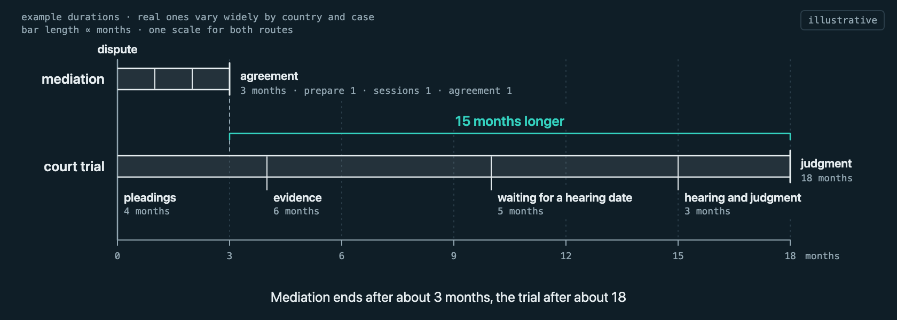 | `mediation-vs-trial` | race | compare | axis | law | 1680×600 | 8.8 s | The same dispute on one month axis; mediation and trial bars grow together at the same rate, mediation stops at 3 months, the trial runs on alone through four stages to 18, and a bracket marks 15 months longer (illustrative durations). |
| 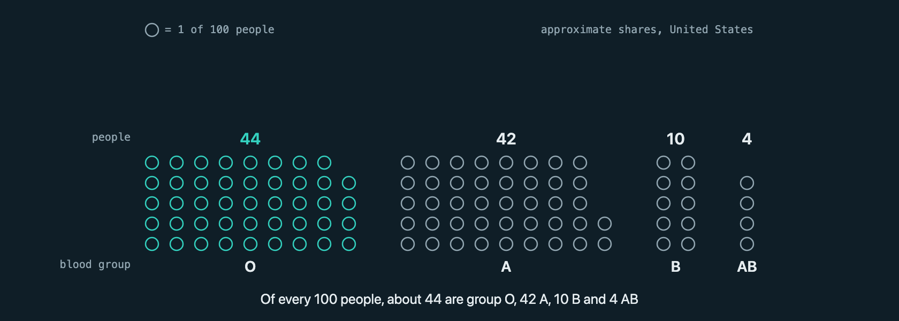 | `blood-types` | sort | compare | matrix | health | 1680×600 | 9.4 s | One crowd of 100 people, one ring each, sorts itself by ABO blood group into blocks in columns of five (about 44 O, 42 A, 10 B, 4 AB in the US); the counts land and the largest group takes the accent. |
| 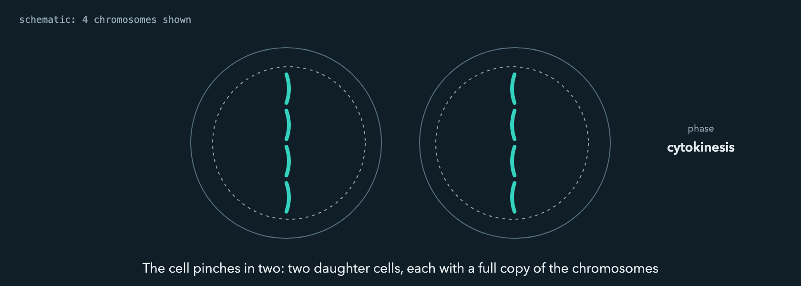 | `mitosis` | split | states | scene | biology | 1680×600 | 10 s | Four copied chromosomes line up at the middle of a cell, their sister chromatids are pulled to opposite poles, a nucleus forms at each pole and the cell pinches into two daughter cells, each with a full copy. |
| 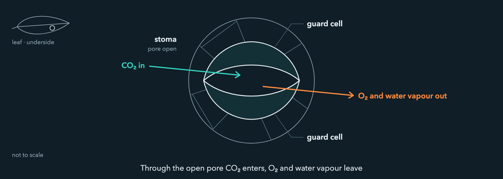 | `leaf-stomata` | zoom | layers | scene | biology | 1680×600 | 9.3 s | A leaf seen from its underside; the view zooms into one marked spot until a single stoma fills the frame, the guard cells bow apart to open the pore, and CO2 goes in while O2 and water vapour come out. |
| 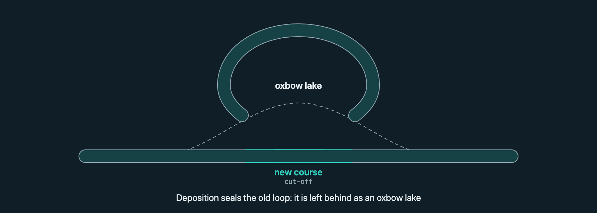 | `oxbow-lake` | transform | states | scene | earth-science | 1680×600 | 9.5 s | A river bend tightens into a loop with a narrow neck, a flood cuts through the neck, and the sealed-off loop is left behind as an oxbow lake. |
| 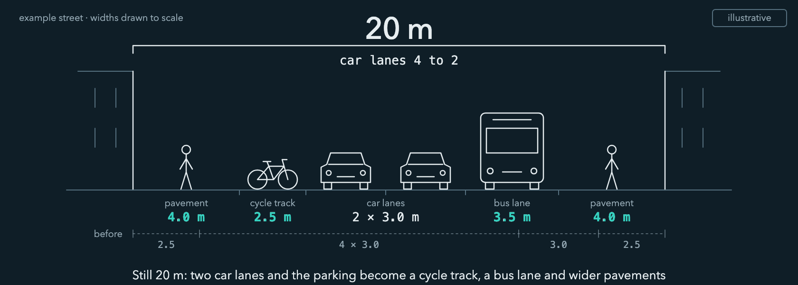 | `street-redesign` | wipe | compare | scene | civics | 1680×600 | 8.4 s | An example 20 m street is redivided; a boundary line sweeps across and two car lanes and the parking give way to a cycle track, a bus lane and wider pavements, while the building edges and the 20 m bracket stay put (illustrative widths). |
| 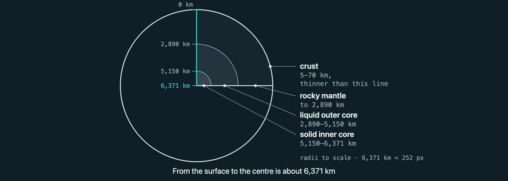 | `earth-layers` | open | layers | scene | earth-science | 1680×600 | 9.9 s | A closed Earth has a quarter cut away; the layers show at true radial proportion and are named from the outside in (crust, rocky mantle, liquid outer core, solid inner core), then a depth scale draws from 0 at the surface to 6,371 km at the centre. |
| 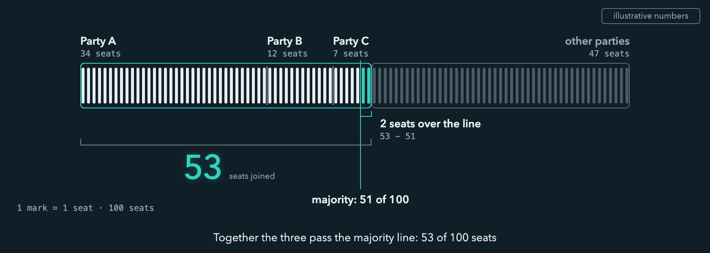 | `coalition-majority` | merge | compare | bands | civics | 1680×600 | 9.2 s | No party has a majority alone; Party B joins Party A, then Party C joins both, and together their 53 seats pass the majority line at 51 by 2 (illustrative seats). |

All are `data-anim-control="once"` (CSS only, no script): one pass of the length in the
Cycle column, played when the slide becomes current, ending on the resting frame. Without a
`.visible` ancestor, and under `prefers-reduced-motion`, each shows that resting frame: the
finished state of the story.

Every entry also carries `data-anim-phases` (stop marks in seconds, listed as `phases` in
`index.yaml`), so it can be integrated in step mode (`integrate_fragment.py --control step`)
without changes: the host plays the same CSS pass segment by segment, one key press per mark.

## Preview

`render-phases.sh` takes a fragment folder or file and writes PNGs to a temp folder it prints:

```sh
scripts/render-phases.sh pool/db-failover 1000 560 1.5 4 7 10 rest
```

Then open every `phase-*.png` and look at it. The generated `preview-*.html` files are paused
stills; for real motion drop the fragment into a page with a `.visible` ancestor (or use
`scripts/snippets/observer.html`) and open that in a browser.

## Scaffold from a spec

```sh
python3 scripts/scaffold_from_spec.py pool/deploy-pipeline/spec.yaml -o /tmp/anim/my-pipeline/my-pipeline.html
```

Rename `name:` in the spec first when you adapt it, so prefixes stay unique within the deck.

## Retheme

The fragments read only `--anim-*` tokens, which fall back to a neutral dark palette.
Set the `--anim-theme-*` variables once on `:root` (or on a slide) in the host page:

```css
:root {                          /* example: a light theme */
  --anim-theme-bg: #ffffff;       /* must match the slide background: label plates use it */
  --anim-theme-panel: #f2f4f8;
  --anim-theme-line: #c5ccd8;
  --anim-theme-fg: #14181f;
  --anim-theme-muted: #5b6474;
  --anim-theme-accent: #0a6cff;
  --anim-theme-accent-2: #c2410c;
  --anim-theme-ok: #1b7a36;
  --anim-theme-warn: #b35a00;
  --anim-theme-danger: #c92a2a;
  --anim-theme-font: 'Inter', system-ui, sans-serif;
  --anim-theme-mono: 'JetBrains Mono', ui-monospace, monospace;
}
```

Fills mixed from `--anim-bg` (label plates, tinted tags) assume it matches the slide
background; if `--anim-theme-bg` differs they show as faint boxes.

## Private pools

Fragments with work- or client-specific content do not belong here. Keep them in a folder of
your own with the same layout (`<name>/<name>.html`, optional `index.yaml`) and point
`ANIM_POOL` at it; the agent searches it after this pool.

## Contributing

A new entry needs: a domain-neutral story, a clean `check_fragment.py` run at the viewBox width,
phase renders you have looked at, `data-anim-verb` on the wrapper, `thumb.png` from the `rest`
render, and a row in `index.yaml` (with `verb`, `form` and `moves`) and in the table above. A
new entry with a travelling marker needs a named traveller and must keep the pool under the
one-third limit.
