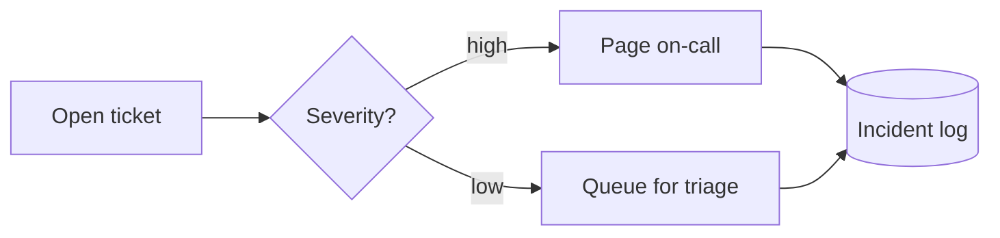

# Spec format

The spec is the intermediate step between understanding the content and drawing the fragment.
Extract it from prose, bullets, Mermaid or slide text; save it as `anim/<name>/spec.yaml`;
`scripts/scaffold_from_spec.py` turns it into a skeleton fragment that satisfies
[fragment-contract.md](fragment-contract.md). The spec records *what* is shown and *when*; the
brief ([brief-template.md](brief-template.md)) records slot, coordinates and theme.

## Full schema

```yaml
name: deploy-pipeline          # kebab-case 2-24 chars, becomes the fragment name
archetype: pipeline            # pipeline | graph | timeline | states | compare | layers | chart
title: "Build to production"   # optional, drawn as a title row if present
size: [1680, 440]              # viewBox W H; optional, archetype default if absent
control: once                  # once (default) | step | loop
cycle: 8                       # pass length in seconds: once and step 4-10, loop 8-15
nodes:
  - id: build                  # kebab-case, unique; rendered id <name>-n-build
    label: Build
    sub: "~3 min"              # optional second line
    kind: process              # process | data | actor | decision | external | store | milestone
    group: ci                  # optional group id
    at: "2024-Q1"              # timeline only: position label
    side: left                 # compare only: one column per distinct value
    layer: 2                   # layers only: 0 = bottom
edges:
  - from: build
    to: test
    label: artifact            # optional
    kind: flow                 # flow | depends | data | event
groups:
  - id: ci
    label: CI
phases:
  - t: 0                       # seconds into the pass; every later phase's t is a data-anim-phases mark
    label: trigger             # kebab-case, a comment next to the keyframe stop
    show: [build]              # node/edge/group ids that enter during this phase
    active: [build]            # ids highlighted during this phase
    flow: ["build>test"]       # edges that carry a moving packet, written from>to
    note: "Commit lands"       # optional caption drawn in a caption strip
series:                        # chart archetype only
  - id: load
    label: Load
    points: [[0, 10], [1, 14]]
events:                        # chart archetype only
  - at: 6
    label: "Peak"
```

## Top-level fields

| Field | Req | Default | Meaning / rules |
|---|---|---|---|
| `name` | yes | - | `^[a-z][a-z0-9-]{1,23}$`, no trailing or double `-`. Fragment name, class prefix, file name. Unique in the deck. |
| `archetype` | yes | - | One of the seven in [archetypes.md](archetypes.md). Picks layout and motion recipe. |
| `title` | no | none | One line, max ~48 chars. Drawn as a title row at the top of the viewBox. Omit when the slide already has a title (usual case). |
| `size` | no | per archetype (below) | `[W, H]`, positive integers, viewBox units. Match the slot's aspect ratio ([layouts.md](layouts.md)). |
| `control` | no | `once` | `once` = CSS keyframes that play one pass when the slide becomes current and hold the finished state; `step` = the same file with `data-anim-control="step"`: the presenter drives it, the host script plays the pass segment by segment between the `data-anim-phases` marks (below), no script in the fragment; `loop` = the same keyframes repeated forever, only when the user asks for a continuous loop (kiosk, gallery, hero). |
| `cycle` | no | `8` (once, step), `12` (loop) | The **pass length** in seconds: 4 to 10 for `once` and `step`, 8 to 15 for `loop` (contract section 6). Becomes `data-anim-cycle`. |
| `domain` | no | none | Metadata only (e.g. `biology`, `finance`), used by `pool/index.yaml`; no effect on layout. |
| `illustrative` | no | `false` | `true` draws the standard outlined "illustrative" tag at the top right; use it whenever the values are examples. |
| `lanes` | no | `false` | Graph only. `true` draws `groups` as full-width horizontal swimlanes (lane name in a left column) with nodes placed by rank inside their lane; ungrouped nodes go in an unlabelled last lane. Ignored with a warning when there are no groups. |
| `nodes` | yes* | - | 1 to 20 entries; warn above 12. *`chart` may have none; chart nodes are ignored by the scaffold with a warning. |
| `edges` | no | `[]` | See edges. |
| `groups` | no | `[]` | See groups. |
| `phases` | no | derived | See phases. If absent, derived by the rule in "Deriving phases". |
| `series` | chart | - | 1 to 3 entries, chart only. |
| `events` | no | `[]` | Chart only. |

Default `size` per archetype (all fit the generic 1920x1080 layouts):

| Archetype | Default size |
|---|---|
| pipeline, timeline | `[1680, 440]` |
| graph, compare, chart | `[1680, 600]` |
| states, layers | `[1200, 600]` |

Unknown top-level keys are an error (catches typos like `phase:`).

## Nodes

| Field | Req | Default | Meaning / rules |
|---|---|---|---|
| `id` | yes | - | `^[a-z][a-z0-9-]{0,23}$`. Unique across nodes, groups, series and events. Rendered `<name>-n-<id>`. |
| `label` | yes | - | Main text, max ~24 chars (wraps badly beyond). Reuse the source's words. |
| `sub` | no | none | Second, smaller line: duration, owner, count. Max ~28 chars. |
| `kind` | no | `process` | Styling tag, see below. |
| `group` | no | none | Must be an id in `groups`. One group per node, no nesting. |
| `at` | timeline | - | Required for `timeline`, forbidden elsewhere. A label (`"Q3"`, `"v2.0"`, `"Day 30"`), not parsed. Position = list order, spaced evenly. |
| `side` | compare | - | Required for `compare`, forbidden elsewhere. Any kebab-case value; each distinct value is one column, in order of first appearance (`left`/`right` for the classic pair; e.g. `green`/`gold`/`diamond` for three). More than 5 rows per side or 4 columns warns. |
| `layer` | layers | - | Required for `layers`, integer >= 0, 0 = bottom; forbidden elsewhere. Max 5 distinct layers. |

`kind` values and their default drawing:

| Kind | Shape | Colour role |
|---|---|---|
| `process` | rounded rect | `--anim-panel` fill, `--anim-line` stroke |
| `data` | rect with folded corner or document glyph | `--anim-panel`, `--anim-mono` label |
| `actor` | person glyph or circle above the label | `--anim-fg` stroke |
| `decision` | diamond (or rect with a diamond badge when the label is long) | `--anim-accent-2` stroke |
| `external` | dashed-outline rect | `--anim-muted` stroke |
| `store` | cylinder | `--anim-panel`, `--anim-line` |
| `milestone` | circle on the axis (timeline) or flag | `--anim-accent` when reached |

Highlighting (`active`) always switches stroke to `--anim-accent` and raises fill with
`color-mix(in srgb, var(--anim-accent) 14%, var(--anim-panel))`, whatever the kind.

## Edges

| Field | Req | Default | Meaning / rules |
|---|---|---|---|
| `from`, `to` | yes | - | Node ids. `from != to`. The pair is the edge id, written `from>to`; at most one edge per ordered pair. Rendered id `<name>-e-<from>-<to>`. |
| `label` | no | none | Short text at the wire's midpoint, max ~16 chars. |
| `kind` | no | `flow` | `flow` = solid wire, packets allowed. `depends` = dashed wire with arrow pointing at the dependency (`from` needs `to`). `data` = solid, thinner, `--anim-mono` label. `event` = dotted, used for async messages, feedback and rollback. |

A reverse edge (`b>a` next to `a>b`) is allowed and drawn as a separate curved wire.
In `pipeline` with no `edges` at all, the scaffold chains the nodes in list order with `flow`
edges; once any edge is given, nothing is implied.

## Groups

| Field | Req | Meaning / rules |
|---|---|---|
| `id` | yes | Same id rules as nodes; unique across all ids. Rendered `<name>-g-<id>`. |
| `label` | yes | Drawn in the group's top-left corner, `--anim-muted`. |

A group is a rounded rect behind its members. A group with no members is an error. Max 4 groups.

## Phases

Phases are the story. Each phase is a moment at which things enter, light up or move.

| Field | Req | Default | Meaning / rules |
|---|---|---|---|
| `t` | yes | - | Seconds. `once`, `step`: `0 <= t <= cycle - 0.8`; `loop`: `0 <= t <= cycle - 1`. All: strictly increasing, first phase `t: 0`, gaps >= 0.8 s (`once`, `step`: >= 0.5 s, warning under 1 s). `--control step` on a once spec (or `once` on a step spec) changes only the wrapper attribute; `--control loop` on a once or step spec, or `once`/`step` on a loop spec, re-times the phases into the new pass, keeping their proportions. |
| `label` | yes | - | Kebab-case, unique among phases. Becomes a comment next to the keyframe stop. |
| `show` | no | `[]` | Ids (node, group, edge as `from>to`, series, event) that enter at `t`. Each id enters at most once across all phases. |
| `active` | no | `[]` | Ids highlighted from this phase until the next phase. Must be visible at this phase. Keep to 1-3 (contract: about a third of elements active at most). |
| `flow` | no | `[]` | Edge ids `from>to` that carry a packet starting at `t`. Edge must exist and both endpoints be visible. Max 3 per phase (contract: three things moving at once). |
| `note` | no | none | Caption, max ~60 chars, shown in the caption strip from this phase until the next note. Any note in the spec reserves the caption strip. |

Implicit entry (so specs stay short):

- A node never named in any `show` is visible from `t: 0` (static background).
- An edge never named in any `show` enters with the later of its two endpoints.
- A group never named in any `show` enters with its first member.
- A chart series never named in any `show` draws on across the action window; an event never
  named enters when the drawn series reaches its `at` (see chart).

Timing semantics:

- `once`: phase *i* lasts from `t_i` to `t_{i+1}`; the last phase lasts until `cycle`, the end
  of the pass. Entrances start at `t` with element duration (300-500 ms); packets take one hop
  (0.6-1.0 s) and travel their path once. The last phase is the **hold**: by convention
  `label: hold`, no `show`, no `flow`, `t` between `cycle - 1.5` and `cycle - 0.8`. Nothing
  resets: the pass ends on the finished state and keeps it (fill-mode `forwards`/`both`). The
  caption strip cross-fades per phase during the pass and the last caption stays.
- `loop`: as `once`, but the hold `t` lies between `cycle - 2` and `cycle - 1` and the final
  ~0.4 s of the cycle is the reset to the empty state before the next round.
- The state at the start of the hold is the resting frame (contract section 5), and under
  `once` also the 100 % keyframe of every track.
- `step`: exactly the `once` pass. The host plays segment 1 (phase 0) when the slide becomes
  current and pauses on the first mark; each key press plays the next phase and pauses on its
  mark; the hold's start, the last mark, is the finished figure. So the same hold rule applies,
  and every phase's motion must finish before the next phase's `t` (a mark is a still frame).

## Phase marks (`data-anim-phases`)

The scaffold always writes `data-anim-phases="m1,m2,..."` on the wrapper, for `once`, `step` and
`loop`: the `t` of every phase after the first, in order, rounded to one decimal, so the hold's
start is the last mark. Without a hold phase the end of the motion (the pass length; `loop`: the
start of the reset) closes the list, and a single phase gives just that end. Marks are strictly
ascending, each > 0 and <= `cycle`. Segment *k* runs from mark *k-1* (0 for the first) to mark
*k*, and is one phase. Under `once` and `loop` the attribute is ignored, so any fragment that
carries it can be switched to `step` at integration time (`integrate_fragment.py --control step`)
without touching the file. After refining keyframes by hand, move a mark that no longer sits
between two phases' motion (nothing may be mid-motion at a mark; render each mark with
`render-phases.sh` and look).

Example: phases at `0, 1.5, 3, 4.5, 6` and a hold at `6.8`, cycle 8 ->
`data-anim-cycle="8" data-anim-phases="1.5,3,4.5,6,6.8"`.

## Series and events (chart only)

| Field | Req | Meaning / rules |
|---|---|---|
| `series[].id` | yes | Id rules as nodes. Rendered `<name>-s-<id>`. |
| `series[].label` | yes | Legend / end-of-line label. |
| `series[].points` | yes | `[[x, y], ...]`, 2 to 200 pairs, numbers, x strictly increasing. All series share the x axis. |
| `events[].at` | yes | x value in series units (not seconds), inside the x range. |
| `events[].label` | yes | Tag text, max ~20 chars. |
| `events[].id` | no | Default `event-1`, `event-2` ... (1-based list order). Rendered `<name>-v-<id>`. |

Axes are scaled from the min/max of all points with 5 % headroom. The x range maps linearly
onto the action window (`0` to the hold's `t`), so a series draws on left to right in step with
time and each event tag appears as the trace reaches it.

## Validation summary

The scaffold refuses a spec when any of these fail; fix the spec, not the fragment.

1. `name`, every id and every phase label are kebab-case and within length.
2. `archetype` and `control` are known values (`once`, `step`, `loop`); `cycle` is 4-10 for
   `once` (the default, so a spec without `control` and with `cycle: 12` is refused with a hint)
   and `step`, and 8-15 for `loop`.
3. All ids are unique across nodes, groups, series and events.
4. Every `group`, `from`, `to` and every id in `show` / `active` / `flow` resolves.
5. Archetype-specific node fields are present where required and absent elsewhere
   (`at` timeline, `side` compare, `layer` layers).
6. Phase `t` values are ordered and in range; nothing is shown twice; `active` and `flow` only
   reference visible things; at most 3 flows per phase.
7. Chart: at least one series, x strictly increasing, events inside the x range.

Warnings (scaffold proceeds): more than 12 nodes, more than 8 phases, more than 16 edges,
a label over its length hint, a pass or loop with no hold phase, a phase gap under 1 s, a once
hold longer than 1.5 s.

## Scaffold conventions

Where the schema leaves a drawing decision open, `scripts/scaffold_from_spec.py` does this:

- **compare panel headers**: a group whose members all sit on one `side` names that panel;
  otherwise the panels are headed "Before" and "After".
- **layer names**: a group whose members all share one `layer` names that band; otherwise
  "Layer N" counted from the bottom.
- **once mode**: one track per element, `animation: <id> <cycle>s linear 1 both`, keyframe
  percentages from the phase seconds, and every 100 % stop set to that element's resting value,
  so the last frame of the pass is the resting frame. `loop` emits the same tracks with
  `infinite` and a reset in the last 0.4 s.
- **state layer**: every highlight copy, every settled (`ok`) copy and the captions sit in one
  `<g id="<name>-state">` after the figure, so a phase change is one opacity swap in one group
  (contract section 8, motion concurrency). Static frame elements (never named in `show`) do
  not fade in under `once`; a chart's head dot appears at the end instead of riding the line.
- **glow**: only one ring glows, the outcome (the first node active in the last phase, else the
  last highlighted node); wires, brackets, rules and chart series get a plain accent copy.
- **step mode**: the once output, byte for byte, except `data-anim-control="step"` and the motion
  comment; the phase marks come from the phase starts (above). No GSAP, no script.
- **`active` on series or events** is ignored; highlight them by order of entry instead.
- **fonts**: with `--rendered-width` the base sizes are raised until every text meets
  `--min-text` at that width; the scaffold warns when a label may then overflow its box.

## Deriving phases when the source has none

Most sources describe structure, not timing. Default rule:

1. Order the nodes in reading order (list order of the source; for graphs, topological order
   from sources to sinks, ties by list order).
2. Let `n` = number of nodes, `hold = 1.2` s (`loop`: 2 s), `step = round_half((cycle - hold) / n)`.
   If `step < 0.8`, raise `cycle` up to 10 (`loop`: 15); if still too small, split the spec.
3. Phase *i* (0-based) at `t = i * step`: `show: [node_i]`, `active: [node_i]`,
   `flow: [every edge into node_i from an earlier node]`, `label` = the node id.
4. Last phase: `t = cycle - hold`, `label: hold`, `active` = the outcome node (sink) or empty.
5. Write one `note` per phase only where the source gives a sentence for that step.

Example: 5 nodes, cycle 8 -> step 1.5 -> phases at 0, 1.5, 3, 4.5, 6, hold at 6.8, pass ends at 8.
(`loop`, cycle 12 -> step 2.0 -> phases at 0, 2, 4, 6, 8, hold at 10.)

`step` control uses the same timing as `once` (hold included).

## Keeping a spec small

- About 12 nodes per illustration is the ceiling for legible text at 18 px on a slide.
- More than that: split by group (one illustration per subsystem), by time (before / after),
  or collapse leaves into one node (`"4 worker services"`).
- 3 to 6 phases is typical; more than 8 means the story is two stories.
- Prefer one edge kind per spec, two at most. Edge labels only where the label is the point.
- Drop nodes the speaker will not mention.

## Mermaid mapping

### `flowchart` / `graph` (LR, RL, TD, TB, BT)

| Mermaid | Spec |
|---|---|
| `A[Text]` | node `id: a`, `label: Text`, `kind: process` |
| `A(Text)`, `A([Text])` | `kind: process` |
| `A[(Text)]` | `kind: store` |
| `A{Text}` | `kind: decision` |
| `A((Text))` | `kind: actor` (or `milestone` in a timeline) |
| `A[/Text/]`, `A[\Text\]` | `kind: data` |
| `A>Text]` (flag shape) | `kind: external` |
| `subgraph id [Label] ... end` | group `id`, `label`; members get `group` |
| `A --> B`, `A --- B` | edge `kind: flow` |
| `A -.-> B` | edge `kind: depends` (or `event` if the text says async / on failure) |
| `A ==> B` | edge `kind: flow`; mark `B` active in its phase (emphasis) |
| `A -- text --> B`, `A -->\|text\| B` | edge `label: text` |
| `A --> B & C` | two edges |
| `classDef`, `style`, `linkStyle` | ignored; colours come from tokens |

Mermaid ids are often `A`, `B1`; derive the spec id from the label instead
(`A[Run tests]` -> `run-tests`, shortened to <= 24 chars). Archetype: a single chain with no
branching -> `pipeline`; branches, merges or cycles -> `graph`; decision nodes with "yes/no"
loops back -> `states` if the nodes are conditions rather than actions. Phases: derived rule,
using the Mermaid declaration order as reading order.

### `sequenceDiagram`

| Mermaid | Spec |
|---|---|
| `participant A as Label` / `actor A` | node, `kind: process` / `actor`, in declaration order |
| `A->>B: text` (sync) | edge `a>b`, `kind: flow`, `label: text` |
| `A-->>B: text` (reply), `A-)B` (async) | edge `b>a` or `a>b`, `kind: event` |
| each message, in order | one phase: `flow: ["a>b"]`, `active: [b]`, `note: text` |
| `Note over A,B: text` | `note` of the current phase |
| `loop`, `alt`, `opt`, `par` | flattened: draw the main path once; mention the block in a `note` |
| `activate` / `deactivate` | `active` on that participant |

Archetype: `graph` with participants in one row (left to right in declaration order) or
`layers` when participants are tiers (client / API / DB). Repeated messages between the same
pair reuse the edge; phases carry the order. More than 8 messages: keep the ones the speaker
narrates, merge the rest into notes.

### Others

- `stateDiagram-v2`: states -> nodes, `-->` transitions -> edges with labels, archetype `states`,
  `[*]` start -> the first phase's `active`.
- `timeline` / `gantt`: sections -> milestone nodes with `at`, archetype `timeline`.
- `xychart-beta`: `line` / `bar` -> `series`, archetype `chart`.

## Worked examples

### 1. Prose -> pipeline

Source (release notes of an internal wiki):

> Every release starts when a maintainer tags a commit on main. CI builds the artifacts and runs
> the full test suite, which takes about 20 minutes. If it is green, the build is deployed to
> staging, where QA signs off. Release managers then promote it to production during the Tuesday
> window.

Extraction: five actions in order (tag, build, test, staging, production), one gate (QA sign-off,
folded into staging's `sub`), one duration (tests). No branches -> `pipeline`. Labels reuse the
source's words.

```yaml
name: release-flow
archetype: pipeline
cycle: 9
nodes:
  - {id: tag, label: Tag commit, sub: maintainer, kind: actor}
  - {id: build, label: Build, sub: CI}
  - {id: test, label: Test suite, sub: "~20 min"}
  - {id: staging, label: Staging, sub: QA sign-off}
  - {id: production, label: Production, sub: Tuesday window, kind: milestone}
phases:
  - {t: 0, label: tag, show: [tag], active: [tag], note: "A maintainer tags main"}
  - {t: 1.5, label: build, show: [build], active: [build], flow: ["tag>build"]}
  - {t: 3, label: test, show: [test], active: [test], flow: ["build>test"], note: "Full suite, about 20 minutes"}
  - {t: 4.5, label: staging, show: [staging], active: [staging], flow: ["test>staging"], note: "Green builds go to staging for QA"}
  - {t: 6, label: production, show: [production], active: [production], flow: ["staging>production"], note: "Promoted in the Tuesday window"}
  - {t: 7.8, label: hold, active: [production]}
```

No `edges`: the pipeline chains nodes in list order.

### 2. Bullets -> graph

Source (slide text):

> **Data platform dependencies**
> - Dashboards and alerting read the warehouse
> - The warehouse is loaded by the nightly ETL job
> - ETL needs the ingest service and the object store
> - Ingest pulls from an external billing feed

Extraction: "read / is loaded by / needs / pulls from" are dependencies -> `depends` edges from
the dependant to the dependency (the passive "is loaded by" still makes the warehouse the
dependant). The billing feed is `external`, the warehouse and the object store are `store`.
Groups from the obvious split: consumers vs. platform. Phases: topological order from the
consumers down, but paired siblings enter together to stay under 6 phases.

```yaml
name: data-deps
archetype: graph
cycle: 9
nodes:
  - {id: dashboards, label: Dashboards, kind: actor, group: consumers}
  - {id: alerting, label: Alerting, kind: actor, group: consumers}
  - {id: warehouse, label: Warehouse, kind: store, group: platform}
  - {id: etl, label: Nightly ETL, group: platform}
  - {id: ingest, label: Ingest service, group: platform}
  - {id: object-store, label: Object store, kind: store, group: platform}
  - {id: billing-feed, label: Billing feed, kind: external}
edges:
  - {from: dashboards, to: warehouse, kind: depends}
  - {from: alerting, to: warehouse, kind: depends}
  - {from: warehouse, to: etl, kind: depends}
  - {from: etl, to: ingest, kind: depends}
  - {from: etl, to: object-store, kind: depends}
  - {from: ingest, to: billing-feed, kind: depends}
groups:
  - {id: consumers, label: Consumers}
  - {id: platform, label: Data platform}
phases:
  - {t: 0, label: consumers, show: [dashboards, alerting], active: [dashboards, alerting], note: "Two consumers, one warehouse"}
  - {t: 1.5, label: warehouse, show: [warehouse], active: [warehouse], flow: ["dashboards>warehouse", "alerting>warehouse"], note: "Dashboards and alerting read the warehouse"}
  - {t: 3, label: load, show: [etl], active: [etl], flow: ["warehouse>etl"], note: "The nightly ETL job loads it"}
  - {t: 4.5, label: inputs, show: [ingest, object-store], active: [ingest, object-store], flow: ["etl>ingest", "etl>object-store"], note: "ETL needs ingest and the object store"}
  - {t: 6, label: outside, show: [billing-feed], active: [billing-feed], flow: ["ingest>billing-feed"], note: "Everything rests on one external feed"}
  - {t: 7.8, label: hold, active: [billing-feed]}
```

### 3. Mermaid -> spec

Source:

````markdown

````

Extraction: a decision with two branches merging into a store -> `graph` (not `pipeline`).
Ids from labels. Edge labels kept because they are the point. Phases: derived rule, but the two
branches get one phase each so the decision reads as a choice; the high branch is shown first
and carries the packet.

```yaml
name: ticket-routing
archetype: graph
cycle: 8.2
nodes:
  - {id: open-ticket, label: Open ticket}
  - {id: severity, label: "Severity?", kind: decision}
  - {id: page-on-call, label: Page on-call}
  - {id: queue-triage, label: Queue for triage}
  - {id: incident-log, label: Incident log, kind: store}
edges:
  - {from: open-ticket, to: severity}
  - {from: severity, to: page-on-call, label: high}
  - {from: severity, to: queue-triage, label: low}
  - {from: page-on-call, to: incident-log}
  - {from: queue-triage, to: incident-log}
phases:
  - {t: 0, label: open, show: [open-ticket], active: [open-ticket], note: "A ticket is opened"}
  - {t: 1.2, label: decide, show: [severity], active: [severity], flow: ["open-ticket>severity"], note: "Severity decides the route"}
  - {t: 2.6, label: high, show: [page-on-call], active: [page-on-call], flow: ["severity>page-on-call"], note: "High: page the on-call engineer"}
  - {t: 4, label: low, show: [queue-triage], active: [queue-triage], flow: ["severity>queue-triage"], note: "Low: queue for triage"}
  - {t: 5.4, label: log, show: [incident-log], active: [incident-log], flow: ["page-on-call>incident-log", "queue-triage>incident-log"], note: "Both end in the incident log"}
  - {t: 7, label: hold, active: [incident-log]}
```

Layout notes the scaffolder applies on its own (all in the lean style of `style.md`: rings with
the text outside, hairline brackets for groups, plain captions, one accent with glow):
- **pipeline** wraps into a two-row snake (wrap wire round the right end) when one row would
  make the boxes narrower than their labels; otherwise it warns with a suggested width.
- **compare** spreads rows over the full height and stacks `sub` under the label when a row is long.
- **graph** orders each rank by the barycenter of its neighbours (spec order breaks ties, so
  swapping two nodes in the spec swaps them in the output), routes rank-skipping and back edges
  around nodes, draws `kind: decision` as a real diamond when the text fits, and wraps group
  labels. Crossings that remain are reported as a warning.
- **Nothing is written outside the viewBox.** When a layout cannot fit at the legibility floor
  the scaffold stops and names the smallest size that works (`pass --viewbox 2600 600`).
- A hold phase without its own `active`/`show` keeps the previous phase's state, so the resting
  frame shows the story's end.
- **timeline** draws `groups` as brackets under the axis, stacked where spans overlap.
- The resting frame keeps the last phase's `note` as its caption: give the hold phase a note
  that summarises the story (the scaffold warns when it has none).

More examples: the `spec.yaml` files in [`pool/`](../pool/), listed in `pool/index.yaml`.
